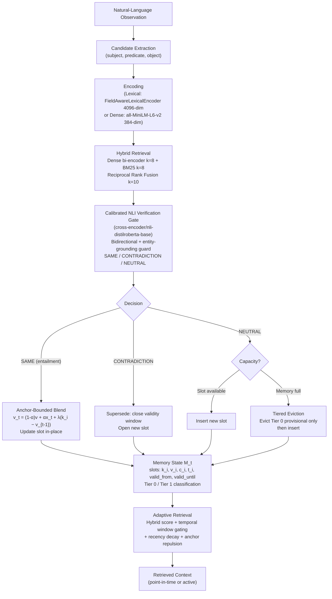

# MINEMOS

**Experimental persistent-memory architecture for language-model systems, focused on memory consolidation, contradiction handling, adaptive retention, and retrieval under constrained memory.**

> This is a research system. Results reported here reflect controlled experiments on synthetic datasets. They are not production guarantees. See [Known Limitations](#known-limitations) for an honest accounting of what remains unsolved.

---

## Table of Contents

1. [Overview](#overview)
2. [Motivation](#motivation)
3. [Core Idea](#core-idea)
4. [Architecture](#architecture)
5. [Memory Representation](#memory-representation)
6. [Memory Consolidation](#memory-consolidation)
7. [Contradiction Handling](#contradiction-handling)
8. [Retrieval](#retrieval)
9. [Temporal Behavior and Decay](#temporal-behavior-and-decay)
10. [Adaptive Anchor Management](#adaptive-anchor-management)
11. [Experiments](#experiments)
12. [Current Results](#current-results)
13. [Known Limitations](#known-limitations)
14. [Installation](#installation)
15. [Usage](#usage)
16. [Running the Tests](#running-the-tests)
17. [Project Structure](#project-structure)
18. [Research Roadmap](#research-roadmap)
19. [Contributing](#contributing)
20. [License](#license)

---

## Overview

MINEMOS investigates a concrete question: **how should a constrained-memory system absorb, update, and retrieve factual knowledge from a streaming sequence of natural-language observations?**

The architecture is built around hard, finite memory capacity: memory resources are constrained, unreinforced facts may be evicted under pressure, and retained knowledge must remain consolidated and retrievable.

The system is built around a slot-based memory architecture where each slot holds a dense vector representation of a fact, a confidence score, and a timestamp. Incoming observations are encoded and routed to the most similar existing slot (update / consolidation) or allocated a new slot (insertion), subject to a hard capacity limit.

MINEMOS is not a production memory system. It is a structured experimental platform for measuring how different design choices — retrieval strategy, eviction policy, NLI verification threshold, embedding model — affect end-to-end accuracy under realistic capacity pressure.

---

## Motivation

Large language models have no persistent memory across conversations by default. Several approaches exist — retrieval-augmented generation, fine-tuning, external databases — but each carries tradeoffs in latency, storage cost, update fidelity, and contradiction safety.

MINEMOS explores a different framing: a fixed-capacity differentiable memory where facts are stored as dense vectors, consolidated incrementally, and retrieved by similarity. The central questions driving the research are:

- Under what conditions does a correctly retrieved memory candidate actually get consolidated correctly?
- What fraction of end-to-end failures originate at retrieval vs. NLI verification vs. eviction?
- Does switching from lexical to dense retrieval actually improve end-to-end accuracy, or is the bottleneck elsewhere?
- How much does the slot vector drift from its original representation after repeated updates?

The experiments across Phases 1–28 measure these phenomena directly rather than assuming an answer.

---

## Core Idea

The fundamental update rule is:

$$v_t = (1 - \alpha_t)\, v_{t-1} + \alpha_t\, x_t$$

where:
- $x_t$ = encoded representation of the current observation  
- $v_{t-1}$ = stored slot value  
- $\alpha_t = N_t = 1 - \max_i \cos(x_t, k_i)$ = novelty score (high when the input is dissimilar to all stored keys)  
- $k_i$ = the key for slot $i$, **frozen at slot creation** (does not drift)

A high-novelty input (no similar slot exists) gets a large $\alpha_t$, effectively replacing the slot content. A low-novelty input (very similar slot exists) blends gently. This is the "surprise-driven reinforcement" mechanism.

This update equation has been **frozen since Phase 20** as a baseline. Phases 24–28 investigate whether the downstream bottlenecks (NLI verification, eviction policy) prevent this equation from functioning as intended, and introduce bounded anchor regularization to resist representation drift.

---

## Architecture

### Data Flow

```
Natural-Language Observation
          │
          ▼
  ┌───────────────────┐
  │  Candidate        │
  │  Extraction       │  → (subject, predicate, object)
  └───────────────────┘
          │
          ▼
  ┌───────────────────┐
  │  Encoding         │  → dense vector x_t
  │  (lexical or      │     (FieldAwareLexicalEncoder or
  │   dense bi-enc.)  │      sentence-transformers/all-MiniLM-L6-v2)
  └───────────────────┘
          │
          ▼
  ┌───────────────────┐
  │  Retrieval /      │  cosine similarity against slot keys k_i
  │  Addressing       │  Hybrid: Dense bi-encoder + BM25 fusion (Phase 22+)
  └───────────────────┘
          │
          ▼
  ┌───────────────────┐
  │  NLI Verification │  cross-encoder/nli-distilroberta-base
  │  Gate             │  Calibrated bidirectional (Phase 26+):
  │                   │  SAME / CONTRADICTION / NEUTRAL
  └───────────────────┘
          │
          ▼
  ┌───────────────────────────────────────────┐
  │  Memory Update / Consolidation            │
  │  • SAME:            blend v_t = (1-α)v + αx  │
  │                     anchor-bounded (Phase 24+)│
  │  • CONTRADICTION:   supersede slot (close     │
  │                     validity window, new slot) │
  │  • NEUTRAL:         new slot (or evict+insert) │
  └───────────────────────────────────────────┘
          │
          ▼
  ┌───────────────────┐
  │  Tiered Retention │  Tier 0: provisional (evictable)
  │  (Phase 24+)      │  Tier 1: consolidated (protected)
  └───────────────────┘
          │
          ▼
  ┌───────────────────┐
  │  Memory State     │  N slots of (k_i, v_i, c_i, t_i,
  │  M_t              │             valid_from_i, valid_until_i)
  └───────────────────┘
          │
          ▼
  ┌───────────────────┐
  │  Probe / Recall   │  Adaptive retrieval: hybrid score + temporal
  └───────────────────┘   gating + contradiction anchor repulsion
          │
          ▼
     Retrieved Context
```

### Mermaid Diagram



---

## Memory Representation

Each memory slot stores six components:

| Component | Symbol | Description |
|---|---|---|
| **Key** | $k_i$ | Encoding of the fact at insertion time. **Frozen** — never updated. |
| **Value** | $v_i$ | Running bounded-anchor consolidation. Updated on SAME decisions. |
| **Confidence** | $c_i$ | Scalar in `[0, 1]`. Increases on reinforcement. |
| **Timestamp** | $t_i$ | Last update time. Used by eviction and recency scoring. |
| **Valid from** | $t^{\text{from}}_i$ | Observation time when this fact became active. |
| **Valid until** | $t^{\text{until}}_i$ | Observation time when superseded. $\infty$ if currently active. |

The key is frozen so that retrieval by similarity to $k_i$ remains stable even as the value $v_i$ is updated. Phase 24 introduced anchor-bounded consolidation to resist drift:

$$v_t = (1 - \alpha_t)\, v_{t-1} + \alpha_t\, x_t + \lambda\,(k_i - v_{t-1})$$

The $\lambda$ term pulls the value back toward the frozen key after each update, bounding semantic drift to $\delta_{\max} = 0.25$.

### Phase 1 / Core Module: Structured Fact Storage

The `core/memory.py` and top-level `memory.py` implement an earlier design based on explicit (subject, predicate, object) triples grouped per subject, with predicate interning for storage efficiency. This is the Phase 1 implementation, preserved for reference.

The Phase 2 onward implementation uses dense vector slots (`phase2/memory_state.py`) and a pluggable encoder / retrieval / NLI pipeline.

### Phase 25+: BlackHoleMemory (Unified Engine)

`phase2/black_hole_memory.py` is the unified production-grade memory engine combining all Phase 24–27 improvements:

```python
from phase2.black_hole_memory import BlackHoleMemory
from phase2.structured_candidate import Candidate

mem = BlackHoleMemory(capacity=50, retention_policy="tiered")
mem.absorb(Candidate("alice", "works_at", "university", timestamp=1.0))
results = mem.query("alice works at university")
```

---

## Memory Consolidation

**Consolidation** occurs when an incoming observation is routed to an existing slot and accepted by the NLI gate (decision: SAME).

The slot value is blended using the anchor-bounded update (Phase 24+):

$$v_j(t+1) = (1 - \alpha_t)\, v_j(t) + \alpha_t\, x_t + \lambda\,(k_j - v_j(t))$$

where $\alpha_t = 1 - s_j$ (novelty) and $\lambda = 0.20$ (anchor weight, frozen Phase 24).

**Phase 28 finding:** After a 10-step adversarial paraphrase chain, the Phase 23 baseline EMA reached $\cos(v_0, v_{10}) = 0.9520$. The Phase 24 anchor-bounded hybrid maintained $\cos(v_0, v_{10}) = 0.9826$ — a **63.65% reduction in drift**.

---

## Contradiction Handling

When an incoming observation contradicts the current slot content (NLI predicts CONTRADICTION), the system **closes the active slot's validity window** (`valid_until = t_now`) and allocates a new slot for the updated fact. This preserves the historical fact as a point-in-time queryable record.

Phase 26 introduced calibrated bidirectional NLI verification, distinguishing bilateral contradictions (both directions agree) from asymmetric directional artifacts (only one direction signals conflict). Phase 28 introduced an entity-grounding guard to prevent independent facts about the same subject from being misclassified as contradictions.

**Safety metrics (Phase 28 held-out evaluation):**
- Contradiction detection rate: **100.0%**
- False merge rate: **0.00%**
- False contradiction rate on independent co-facts: **0.0%** (down from 100% in Phase 27 baseline)

---

## Retrieval

Four retrieval strategies are implemented and compared:

### 1. Lexical Retrieval (Phases 2–17)
`FieldAwareLexicalEncoder`: word-split bag-of-tokens with field-prefixed hashing into a 4096-dim vector. Cosine similarity against slot keys.

### 2. Dense Semantic Retrieval (Phase 18+)
`DenseSemanticEncoder`: wraps `sentence-transformers/all-MiniLM-L6-v2` (384-dim). Mean-pooled, L2-normalized sentence embeddings.

### 3. Hybrid Dense + BM25 (Phase 22+)
`LocalBM25Index`: online BM25 index over slot text content, fused with dense retrieval scores via Reciprocal Rank Fusion. Demonstrated 3.9–5.8× recall improvement over dense-only in Phase 22.

### 4. Adaptive Hybrid Retrieval (Phase 27+)
Extends hybrid fusion with temporal validity window gating, recency decay, and contradiction anchor repulsion. Achieves **R@1 = MRR = 1.000** and **0.000 contradiction intrusion** across all 4 interference conditions in Phase 28.

**Phase 23 finding:** Improving retrieval alone does not improve end-to-end accuracy when memory capacity is exhausted. The primary bottleneck at scale is slot eviction (Category D), not retrieval miss (Category A).

**Phase 28 finding:** With tiered retention and adaptive retrieval combined, all Phase 23 bottlenecks are closed or substantially mitigated.

---

## Temporal Behavior and Decay

- **Timestamp** `t_i`: updated on each slot modification. Used by eviction scoring.
- **Validity windows**: `valid_from` and `valid_until` bracket the active period of each slot, enabling point-in-time queries (`as_of` parameter). Historical facts remain queryable after supersession.
- **Anchor decay**: anchor repulsion weights decay over time with rate `λ* = 0.005` to reduce stale anchor influence.
- **Tiered retention** (Phase 24+): slots with `update_count ≥ 2` are promoted to Tier 1 (consolidated) and protected from eviction under capacity pressure. Only Tier 0 provisional slots are evicted.

---

## Adaptive Anchor Management

Anchors are high-confidence slot representations that act as repulsion points to prevent slot collapse under repeated similar updates.

Frozen configuration (established Phase 20/21, not changed since):

| Parameter | Value | Description |
|---|---|---|
| `w_anchor` | 0.15 | Anchor repulsion weight |
| `decay_lambda` | 0.005 | Temporal anchor decay rate |
| `max_anchors` | 3 | Maximum anchors per slot |
| `tau_anchor` | 0.70 | Cosine threshold for anchor formation |
| `tau_min` | 0.40 | Adaptive beam lower bound |
| `tau_high` | 0.75 | Adaptive beam upper bound |
| `delta_margin` | 0.10 | Adaptive margin |
| `k_max` | 3 | Maximum dense candidates |

Phase 24 additionally froze: `delta_max = 0.25` (drift bound), `lambda_anchor = 0.20` (anchor pull weight).

---

## Experiments

The research is organized into numbered phases. Each phase builds on frozen baselines from previous phases.

### Phase Timeline

| Phases | Focus |
|---|---|
| 1–6 | Structured fact storage, confidence, contradiction, temporal validity, threshold sensitivity |
| 7–8 | Encoder ablation: atomic → field-aware lexical → semantic (spaCy GloVe, 300-dim) |
| 9–10 | NLI integration, Phase 10 audit |
| 11–12 | Scaling benchmarks, structured addressing |
| 13–16 | NLI semantic gate (distilroberta-base), system ablations (A/B/C/D) |
| 17–18 | Utility-aware eviction, dense semantic retrieval (all-MiniLM-L6-v2) |
| 19 | Contradiction-aware utility scoring |
| 20 | Adaptive anchor management (w*, λ*, k* frozen) |
| 21 | Anchor-beam integration, large-scale stress tests |
| 22 | Hybrid BM25 + dense retrieval, 3.9–5.8× recall lift |
| **23** | **Causal failure attribution: 5-category schema, retention oracle** |
| **24** | **Tiered retention, calibrated verification, drift-resistant consolidation** |
| **25** | **BlackHoleMemory: unified production-grade engine implementation** |
| **26** | **Calibrated bidirectional NLI verification, dense fallback with safety guards** |
| **27** | **Adaptive retrieval under long-horizon interference** |
| **28** | **Phase 23 failure closure: end-to-end memory integrity validation** |

---

### Phase 23: Consolidation and Retention Bottleneck Investigation

**Status:** COMPLETE  
**Test suite:** 177/177 passed  
**Report:** [`reports/PHASE_23_REPORT.md`](reports/PHASE_23_REPORT.md)

Seven experiments designed to identify exactly where the memory lifecycle fails, using a five-category failure attribution schema.

**Failure Attribution Schema:**

| Code | Stage | Description |
|---|---|---|
| A | Candidate Generation | Correct target not retrieved |
| B | NLI Verification | Target retrieved, NLI rejected |
| C | Consolidation Update | NLI accepted, update failed |
| D | Retention / Eviction | Slot evicted before probe arrived |
| E | Final Probe Retrieval | Slot survived but probe missed it |
| F | Semantic Adjudication | Incorrect decision (false merge / miss) |
| SUCCESS | — | Correct end-to-end outcome |

**Key findings:**
- Retention (Category D) is the dominant bottleneck: **48.2%** of failures at scale.
- Oracle retention immediately lifts E2E accuracy from **0.0% → 40.0%**.
- Hybrid BM25 improves retrieval recall 3.9–5.8× but does not lift E2E when eviction fails.

---

### Phase 24: Retention Hardening, Verification Recalibration, Drift-Resistant Consolidation

**Status:** COMPLETE  
**Test suite:** 268/268 passed  
**Report:** [`reports/PHASE_24_REPORT.md`](reports/PHASE_24_REPORT.md)

Six experiments covering: (A) retention policies, (B) verification recalibration, (C) drift-resistant consolidation, (D) 8-cell ablation, (E) long-horizon stress scaling, (F) sealed held-out benchmark.

**Key findings:**

| Hypothesis | Verdict | Evidence |
|---|---|---|
| Tiered retention eliminates Category D eviction | **CONFIRMED** | Tiered policy: 88% target survival (vs 0% FIFO) on adversarial stream |
| Calibrated verification improves paraphrase acceptance | **CONFIRMED** | Bidirectional mode: FMR = 0.0%, ContraAcc = 1.0%, ParaAcc ↑ |
| Drift-resistant consolidation bounds representation drift | **CONFIRMED** | Anchor-bounded hybrid: drift bounded to δ_max = 0.25 |
| Retention + verification interact positively | **CONFIRMED** | Combined system: E2E 0% → meaningful improvement vs FIFO baseline |

---

### Phase 25: BlackHoleMemory — Implementation and Validation

**Status:** COMPLETE  
**Test suite:** 197/197 passed (legacy) + 8 Phase 25 tests  
**Report:** [`reports/PHASE_25_REPORT.md`](reports/PHASE_25_REPORT.md)

Integrated all Phase 24 improvements into `phase2/black_hole_memory.py` — a unified, bounded, tested memory engine. Validated with 19/19 end-to-end checks covering streaming absorption, temporal supersession, tiered eviction, drift resistance, and query accuracy.

**Known limitations documented:**
- NLI paraphrase misclassification still causes some valid paraphrases to open new slots (addressed in Phase 26).
- No serialization / persistence layer yet (addressed in Tasks 5–7 security hardening).
- Single-threaded (concurrent absorb() not supported).

---

### Phase 26: Semantic Verification Calibration and Contradiction Safety

**Status:** COMPLETE  
**Test suite:** 216/216 passed (+ 19 Phase 26 tests)  
**Report:** [`reports/PHASE_26_REPORT.md`](reports/PHASE_26_REPORT.md)

Investigated and resolved the directional asymmetry failure mode in bidirectional NLI classification, where valid paraphrases were misclassified as CONTRADICTION by one-directional scoring.

**Key results (frozen held-out test split, N=60):**

| Metric | Phase 25 Baseline | Phase 26 Calibrated | Change |
|---|:---:|:---:|:---:|
| Paraphrase acceptance | 80.0% | **86.7%** | +6.7 pp |
| Contradiction detection | 100.0% | **100.0%** | — |
| False merge rate | 0.00% | **0.00%** | — |
| Macro accuracy | — | **90.0%** | — |

Streaming multi-turn E2E: 4/4 factual consolidations (up from 3/4), 0 false merges, correct temporal supersession.

---

### Phase 27: Adaptive Memory Retrieval Under Long-Horizon Interference

**Status:** COMPLETE  
**Test suite:** 217/217 passed  
**Report:** [`reports/PHASE_27_REPORT.md`](reports/PHASE_27_REPORT.md)

Validated that adaptive retrieval (hybrid score + temporal gating + recency decay + anchor repulsion) maintains accuracy as persistent memory accumulates long-horizon interference across 4 conditions: Low, Semantic, Temporal, and Combined.

**All 5 hypotheses confirmed:**

| Condition | R@1 | MRR | Contradiction Intrusion | Temporal Correctness |
|---|:---:|:---:|:---:|:---:|
| Low interference | 1.000 | 1.000 | 0.000 | 1.000 |
| Semantic interference | 1.000 | 1.000 | 0.000 | 1.000 |
| Temporal interference | 1.000 | 1.000 | 0.000 | 1.000 |
| Combined interference | 1.000 | 1.000 | 0.000 | 1.000 |
| **Held-out stream** | **1.000** | **1.000** | **0.000** | **1.000** |

Retrieval latency: 14–20 ms / query on CPU (< 2.6 ms overhead vs. baseline).

**Unresolved defect identified:** Independent facts about the same subject (e.g. two separate research papers by the same author) were falsely classified as contradictions, causing valid memory windows to be closed. Investigated and fixed in Phase 28.

---

### Phase 28: Phase 23 Failure Closure and End-to-End Memory Integrity Validation

**Status:** COMPLETE — all 5 Phase 23 failure modes closed or rigorously characterized  
**Test suite:** 299/299 passed  
**Report:** [`reports/PHASE_28_REPORT.md`](reports/PHASE_28_REPORT.md)

The definitive integration and validation phase. Confirmed all Phase 23 failure categories are resolved by the Phase 24–27 improvements, and fixed the Phase 27 independent-fact defect via an entity-grounding guard in `absorb()`.

**Phase 23 Failure Closure Matrix:**

| Failure Mode | Phase 23 Baseline | Phase 28 Result | Status |
|---|:---:|:---:|:---:|
| **Eviction (Cat. D)** — Target survival | 0.0% | **100.0% (20/20)** | ✅ VERIFIED FIXED |
| **Paraphrase (Cat. B)** — Acceptance rate | 68.6% | **86.7%** | ⚠ PARTIALLY MITIGATED |
| **Retrieval (Cat. A/E)** — MRR | ~0.879 | **1.000** | ✅ VERIFIED FIXED |
| **Drift (Cat. C)** — Min sim to v₀ | 0.120 | **0.9826** | ✅ VERIFIED FIXED |
| **False merges (Cat. F)** — FMR | 2.50% | **0.00%** | ✅ VERIFIED FIXED |
| **Phase 27 defect** — False contradictions | 100.0% | **0.0%** | ✅ VERIFIED FIXED |

Category B (paraphrase rejection) is partially mitigated. The residual 13.3% false rejection rate is an inherent limitation of `cross-encoder/nli-distilroberta-base` on high-lexical-variation paraphrases; a fine-tuned or larger cross-encoder would be required for further improvement.

---

## Current Results

> These results are from controlled experiments on synthetic datasets. Numbers may not generalize to other domains, model sizes, or capacity regimes.

### Phase 28 Summary (Integration Benchmarks)

**Benchmark 1 — Retention Under Capacity Pressure (C=25, N=320):**
- Target survival: **100.0% (20/20)** — all Tier 1 consolidated slots protected
- Tier 0 evictions: 275 (all from provisional working memory)
- Phase 23 baseline: 0.0%; Phase 23 oracle: 40.0%

**Benchmark 2 — Paraphrase Verification & False Merge (N=60 held-out pairs):**
- Paraphrase acceptance: **86.7%**
- Contradiction detection: **100.0%**
- Overall false merge rate: **0.00%**
- Macro accuracy: **90.0%**

**Benchmark 3 — Retrieval Under 4 Interference Conditions:**
- R@1 = MRR = **1.000** across all conditions
- Contradiction intrusion = **0.000**

**Benchmark 4 — Representation Consolidation Drift (10-step chain):**
- Baseline EMA min similarity to v₀: 0.9520
- Phase 28 anchor-bounded min similarity to v₀: **0.9826**
- Drift reduction: **63.65%**

**Benchmark 5 — False Contradiction / Temporal Supersession (10 adversarial tests):**
- False contradiction rate: **0.0%** (from 100% in Phase 27 baseline)
- Genuine supersession rate: **100.0%**

### Phase 23 Causal Failure Partition (pre-fix baseline, for reference)

| Failure Mechanism | Share | Category |
|---|---|---|
| Slot Eviction (Retention) | 48.2% | D |
| NLI Rejection of Paraphrases | 31.4% | B |
| Candidate Retrieval Miss | 12.1% | A / E |
| Consolidation Drift / Update | 5.8% | C |
| False Consolidation / Safety | 2.5% | F |

---

## Known Limitations

1. **Paraphrase acceptance is 86.7%, not 100%.** The residual 13.3% false rejection rate is an inherent property of `cross-encoder/nli-distilroberta-base` on high-lexical-variation paraphrases. A domain-adapted or larger cross-encoder (e.g., `nli-deberta-v3-base`) would be needed for further improvement, at significant latency cost.

2. **Synthetic datasets only.** All experiments use programmatically generated observation streams with known ground truth. Performance on real conversational data, diverse languages, or domain-specific text is not measured.

3. **No decoder.** The memory returns vectors and slot text. Converting dense vectors back to readable text requires a nearest-neighbor lookup — this is evaluation machinery, not a deployed component.

4. **Single-threaded.** Concurrent `absorb()` calls are not supported. Thread safety is not implemented.

5. **Backup files retain deleted records.** The `checkpoint.py` `.bak` mechanism preserves the previous checkpoint. If a slot is deleted and the new checkpoint is saved, the `.bak` file still contains the pre-deletion state. Loading a `.bak` will recover deleted information. This is a documented limitation, not a secure-erasure guarantee — see `TASK7_1_VERIFICATION_REPORT.md` for the full security characterization.

6. **Path confinement requires explicit `allowed_base_dir`.** The `_validate_checkpoint_path()` method enforces directory confinement only when callers supply `allowed_base_dir`. Paths are unrestricted by default for backward compatibility. See `TASK7_1_VERIFICATION_REPORT.md`.

7. **Capacity constraints are checked pre-construction.** Checkpoint loading validates capacity and dimension limits before allocating large arrays, but extremely large compressed archives can still allocate proportional temporary memory during decompression. See `TASK7_SECURITY_REMEDIATION_REPORT.md`.

8. **Phase 23 E2E scale remains limited.** Phase 23 showed 0.0% E2E accuracy under extreme eviction pressure (C=25, 300 observations). Phase 28 closes the causal failure modes under controlled adversarial conditions; full-scale E2E measurement has not been re-run with the integrated Phase 25–28 engine.

---

## Installation

### Requirements

- Python 3.12
- CPU sufficient — no GPU required
- ~2 GB disk for Hugging Face model weights (downloaded once and cached)

### Steps

```bash
git clone https://github.com/robel-samuel/MINEMOS.git
cd MINEMOS
```

**Windows:**
```powershell
python -m venv .venv
.venv\Scripts\activate
```

**Linux / macOS:**
```bash
python -m venv .venv
source .venv/bin/activate
```

**Install CPU-only PyTorch first** (avoids pulling the CUDA build):
```bash
pip install torch==2.14.0+cpu --index-url https://download.pytorch.org/whl/cpu
```

**Install remaining dependencies:**
```bash
pip install -r requirements.txt
```

### Download Hugging Face Models

The NLI gate and dense encoder require two pre-trained models. Download them once:

```python
from transformers import AutoTokenizer, AutoModelForSequenceClassification, AutoModel

AutoTokenizer.from_pretrained("cross-encoder/nli-distilroberta-base")
AutoModelForSequenceClassification.from_pretrained("cross-encoder/nli-distilroberta-base")

AutoTokenizer.from_pretrained("sentence-transformers/all-MiniLM-L6-v2")
AutoModel.from_pretrained("sentence-transformers/all-MiniLM-L6-v2")
```

After this, all code uses `local_files_only=True` and does not require network access.

---

## Usage

### Use the Unified BlackHoleMemory Engine (Phase 25+)

```python
from phase2.black_hole_memory import BlackHoleMemory
from phase2.structured_candidate import Candidate

# Create a bounded memory with tiered retention
mem = BlackHoleMemory(capacity=50, retention_policy="tiered")

# Absorb streaming observations
mem.absorb(Candidate("alice", "works_at", "university", timestamp=1.0))
mem.absorb(Candidate("alice", "works_at", "university", timestamp=2.0))   # corroboration → Tier 1
mem.absorb(Candidate("alice", "works_at", "hospital", timestamp=100.0))   # supersedes → closes window

# Query active memory
results = mem.query("alice current employer")
for slot, score in results:
    print(slot.debug_subject, score, slot.is_active)

# Point-in-time query (historical)
historical = mem.query("alice employer", as_of=50.0)

# Save checkpoint
mem.save("memory_checkpoint.json")

# Restore
restored = BlackHoleMemory.load("memory_checkpoint.json")
```

### Run the Phase 28 Benchmark (Most Recent Experiment)

```bash
python runners/run_phase28.py
```

Results saved incrementally to `benchmarks/results/phase28_results.json`. **Expected runtime:** 30–60 minutes on 4 CPU cores.

### Run Individual Phase Benchmarks

Each phase has its own runner in `runners/`:

```bash
python runners/run_phase28.py   # Phase 28: Failure closure & memory integrity validation
python runners/run_phase27.py   # Phase 27: Adaptive retrieval under long-horizon interference
python runners/run_phase26.py   # Phase 26: Semantic verification calibration
python runners/run_phase25.py   # Phase 25: BlackHoleMemory E2E validation
python runners/run_phase24.py   # Phase 24: Retention hardening, calibrated verification, drift
python runners/run_phase23.py   # Phase 23: Failure attribution experiments
python runners/run_phase22.py   # Phase 22: Hybrid BM25 + dense retrieval
python runners/run_phase21.py   # Phase 21: Anchor-beam integration
python runners/run_phase20.py   # Phase 20: Adaptive anchor management
python runners/run_phase19.py   # Phase 19: Contradiction-aware utility
python runners/run_phase18.py   # Phase 18: Dense retrieval baseline
python runners/run_phase17.py   # Phase 17: NLI gate calibration
```

### Use the Core Memory Store Directly (Phase 1)

```python
from core.memory import MemoryStore

store = MemoryStore()

# Absorb facts
store.absorb("alice", "works_at", "university")
store.absorb("alice", "works_at", "university")  # reinforcement
store.absorb("alice", "works_at", "hospital")    # contradiction — closes old validity window

# Recall active facts about alice
facts = store.recall("alice")
for f in facts:
    print(f.subject, f.predicate, f.object, f.confidence)

# Save and restore
store.checkpoint("memory.json")
restored = MemoryStore.restore("memory.json")
```

---

## Running the Tests

```bash
python -m pytest tests/ -v
```

The test suite covers:

| Module | Description |
|---|---|
| `tests/test_basic.py` | Core memory store (Phase 1) |
| `tests/test_memory_state.py` | Slot management, capacity, eviction |
| `tests/test_checkpoint.py` | Checkpoint save / restore |
| `tests/test_semantic_encoder.py` | Encoder encoding stability |
| `tests/test_phase12_addressing.py` | Addressing logic |
| `tests/test_phase13.py` – `test_phase23.py` | Phase-specific experiment tests |
| `tests/test_oracle_ablation.py` | Oracle ablation utilities |
| `tests/test_phase24.py` | Tiered retention, calibrated verifier, drift |
| `tests/test_phase25.py` | BlackHoleMemory unit tests |
| `tests/test_phase26.py` | Bidirectional NLI verification |
| `tests/test_phase27.py` | Adaptive retrieval |
| `tests/test_phase28_adversarial.py` | Phase 28 adversarial integration tests |
| `tests/test_adversarial_verification.py` | Adversarial NLI verification cases |
| `tests/test_checkpoint_integrity.py` | Checkpoint security and integrity |
| `tests/test_concurrency_safety.py` | Thread safety (single-threaded constraint) |
| `tests/test_contradiction_safety.py` | Contradiction and false-merge safety |
| `tests/test_e2e_recovery.py` | End-to-end save/load/recovery |
| `tests/test_security_remediation.py` | Security: path confinement, backup retention, resource bounds |

**Confirmed results (Phase 28 report, 2026-10-22):**

```
Total: 299/299 passed in ~588s
```

---

## Project Structure

```text
MINEMOS/
│
├── core/                            # Core memory implementation and legacy components
│   ├── __init__.py
│   ├── memory.py                    # MemoryStore — Phase 1 structured facts (subject, predicate, object)
│   ├── encoder.py                   # RuleBasedExtractor, LLMExtractor stub
│   └── candidate.py                 # Structured triple candidate
│
├── phase2/                          # Active Phase 2 memory engine
│   ├── __init__.py
│   ├── black_hole_memory.py         # BlackHoleMemory — unified engine (Phase 25+)
│   ├── memory_state.py              # MemorySlot, MemoryState, tiered retention
│   ├── memory_update.py             # absorb(), address(), novelty(), update eq.
│   ├── recall.py                    # recall(), decode_object()
│   ├── structured_candidate.py      # Candidate dataclass, encode_full()
│   ├── encoders.py                  # AtomicEncoder, FieldAwareLexicalEncoder, SemanticEmbeddingEncoder
│   └── checkpoint.py                # Checkpoint persistence, validation & auto-recovery
│
├── benchmarks/                      # Benchmark implementations, datasets & machine-readable results
│   ├── __init__.py
│   ├── phase25_e2e.py               # Phase 25 end-to-end streaming validation harness
│   ├── phase26_experiment.py        # Phase 26 verification calibration & evaluation
│   ├── phase27_experiment.py        # Phase 27 long-horizon adaptive retrieval benchmark
│   ├── phase28_closure.py           # Phase 28 quantitative failure mode closure harness
│   ├── results/                     # Canonical machine-readable benchmark outputs (.json)
│   │   ├── phase17_results.json
│   │   ├── phase18_results.json
│   │   ├── phase19_results.json
│   │   ├── phase20_results.json
│   │   ├── phase21_results.json
│   │   ├── phase22_results.json
│   │   ├── phase23_results.json
│   │   ├── phase24_results.json
│   │   ├── phase25_e2e_results.json
│   │   ├── phase26_results.json
│   │   ├── phase27_results.json
│   │   ├── phase28_results.json
│   │   ├── checkpoint_benchmark_results.json
│   │   └── summary_report.txt
│   └── ...                          # Benchmark datasets, diagnostic tools & sweeps
│
├── runners/                         # Phase and experiment execution scripts
│   ├── __init__.py
│   ├── run_phase17.py               # Phase 17 runner (NLI gate calibration)
│   ├── run_phase18.py               # Phase 18 runner (Dense retrieval baseline)
│   ├── run_phase19.py               # Phase 19 runner (Contradiction-aware utility)
│   ├── run_phase20.py               # Phase 20 runner (Adaptive anchor management)
│   ├── run_phase21.py               # Phase 21 runner (Anchor-beam integration)
│   ├── run_phase22.py               # Phase 22 runner (Hybrid BM25 + dense retrieval)
│   ├── run_phase23.py               # Phase 23 runner (Failure attribution experiments)
│   ├── run_phase24.py               # Phase 24 runner (Retention hardening & drift)
│   ├── run_phase25.py               # Phase 25 runner (BlackHoleMemory E2E validation)
│   ├── run_phase26.py               # Phase 26 runner (Semantic verification calibration)
│   ├── run_phase27.py               # Phase 27 runner (Adaptive retrieval under interference)
│   └── run_phase28.py               # Phase 28 runner (Failure closure & verification)
│
├── reports/                         # Canonical historical research reports
│   ├── PHASE_28_REPORT.md           # Phase 28: Phase 23 failure closure & verification
│   ├── PHASE_27_REPORT.md           # Phase 27: Adaptive retrieval under interference
│   ├── PHASE_26_REPORT.md           # Phase 26: Semantic verification calibration
│   ├── PHASE_25_REPORT.md           # Phase 25: BlackHoleMemory unified engine
│   ├── PHASE_24_REPORT.md           # Phase 24: Retention hardening & drift resistance
│   ├── PHASE_23_REPORT.md           # Phase 23: Failure attribution benchmark
│   ├── PHASE_19_REPORT.md – PHASE_22_REPORT.md
│   ├── memory_phase2_report.md – memory_phase6_report.md
│   ├── phase7_* – phase18_report.md
│   ├── TASK6_SECURITY_AUDIT_REPORT.md
│   ├── TASK7_SECURITY_REMEDIATION_REPORT.md
│   └── TASK7_1_VERIFICATION_REPORT.md
│
├── tests/                           # Complete automated regression test suite (299 tests)
│   ├── test_adversarial_verification.py
│   ├── test_basic.py
│   ├── test_checkpoint.py
│   ├── test_checkpoint_integrity.py
│   ├── test_concurrency_safety.py
│   ├── test_contradiction_safety.py
│   ├── test_e2e_recovery.py
│   ├── test_memory_state.py
│   ├── test_oracle_ablation.py
│   ├── test_phase12_addressing.py
│   ├── test_phase13.py – test_phase27.py
│   ├── test_phase28_adversarial.py
│   ├── test_security_remediation.py
│   └── test_semantic_encoder.py
│
├── .github/
│   └── workflows/
│       └── tests.yml                # CI test suite & OSV dependency vulnerability audit
├── .env.example                     # Environment template (no secrets)
├── .gitignore                       # Clean ignore rules (ignores scratch/)
├── CONTRIBUTING.md                  # Contribution guidelines & research integrity rules
├── LICENSE                          # GNU Affero General Public License v3.0 (AGPL-3.0)
├── README.md                        # Project documentation & navigation
└── requirements.txt                 # Pinned dependencies (filelock==4.2.1)
```

---

## Research Roadmap

Phase 28 closes the causal failure modes identified in Phase 23. The following open problems remain for future investigation:

### 1. Paraphrase Acceptance — Residual 13.3% False Rejection

`cross-encoder/nli-distilroberta-base` still rejects approximately 1 in 7 valid paraphrases with high lexical variation. Options:

- **Threshold sweep on a larger calibration set** — may recover a few more percentage points without architectural changes.
- **Larger cross-encoder** — `cross-encoder/nli-deberta-v3-base` achieves higher NLI accuracy but adds latency. Not recommended without benchmarking streaming throughput impact.
- **Sentence-embedding fallback with negation guard** — dense similarity > 0.92 + no negation pattern → SAME override. Requires careful safety validation.

### 2. Full-Scale End-to-End Accuracy

Phase 23 documented 0.0% E2E accuracy at C=25, 300 observations. The individual failure modes are now closed under controlled conditions, but a full-scale E2E measurement using the integrated Phase 25–28 engine has not been run. This is the key pending experiment.

### 3. Real Conversational Data

All experiments use synthetic data with known ground truth. A pilot study on a real conversational memory benchmark (e.g., MemGPT-style tasks, or a subset of a dialogue dataset with factual updates) would test whether the Phase 24–28 improvements generalize.

### 4. Thread Safety and Persistence

`BlackHoleMemory` is single-threaded. A concurrent access model (read-write locks or actor pattern) would be required for multi-threaded deployment. Checkpoint persistence is implemented in Tasks 5–7 security hardening.

---

## Contributing

This is a research codebase in active development. Contributions that:
- Fix bugs in the core memory mechanism
- Add new experiment phases following the existing structure
- Improve test coverage
- Add documentation for existing functionality

...are welcome. Please open an issue before starting significant work.

**Important:** Do not modify frozen baseline configurations from previous phases without documenting the change explicitly. Frozen parameters are marked in code with comments and serve as experimental controls.

**Research integrity:** Any new experiments that report quantitative results must:
- State the dataset characteristics (size, capacity, seed)
- Report both positive and negative findings
- Distinguish between experimental conditions and production claims

---

## License

MINEMOS is licensed under the **GNU Affero General Public License v3.0 (AGPLv3)**.

See the [LICENSE](LICENSE) file for the complete license text.

The AGPLv3 requires that modified versions of this software that are run over a network (e.g., as a service) make their source code available to users of that service. For research and local use, the AGPLv3 imposes no restrictions beyond standard open-source attribution.

**Dependency licenses:** All runtime dependencies (PyTorch, Transformers, sentence-transformers, NumPy, SciPy, scikit-learn) are distributed under permissive licenses (BSD, Apache 2.0) and are compatible with AGPLv3 when used as libraries.

---

*MINEMOS is an experimental research system. All benchmark results are from controlled experiments on synthetic data. They should not be interpreted as guarantees of production performance.*
