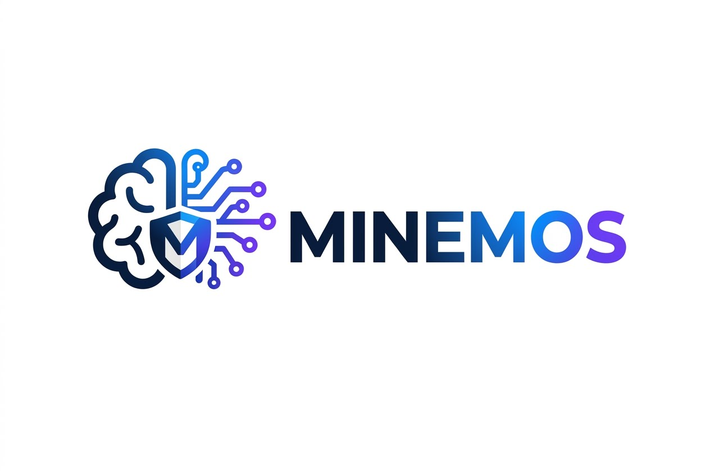
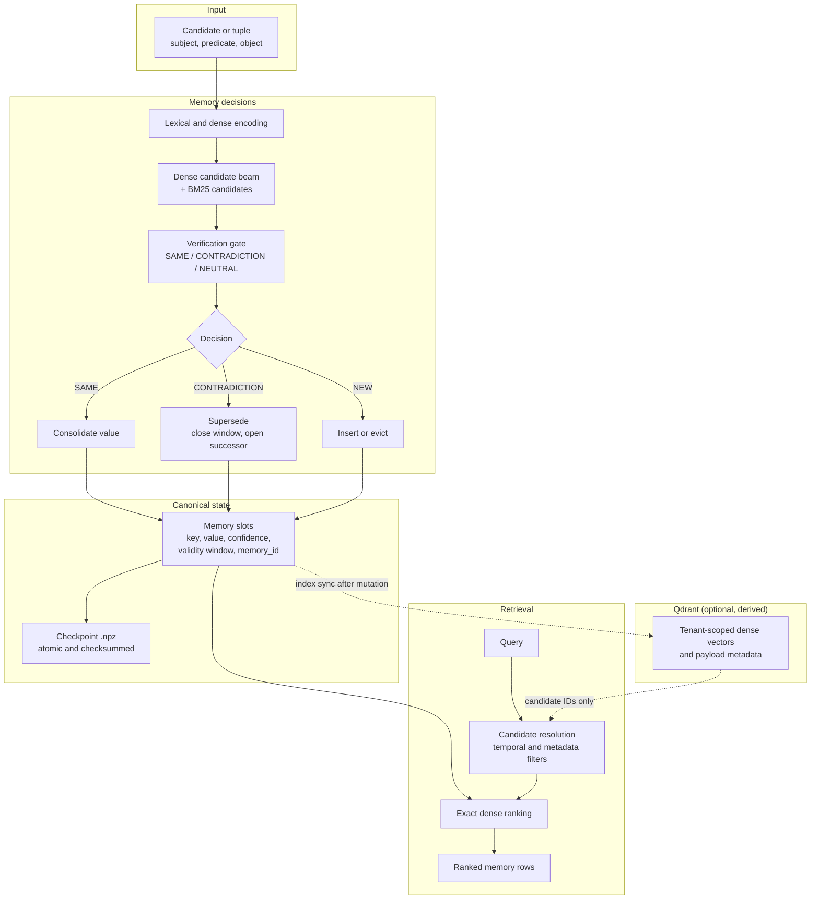

<p align="center">
  
</p>

# MINEMOS

**Persistent memory for AI applications.**

MINEMOS is a Python memory engine that gives an AI application a durable,
self-managing memory. It stores observations, reconciles new information against
what it already knows, keeps superseded state queryable, and returns relevant
facts for later questions.

It is not a vector database and not a retrieval wrapper. A vector index can
accelerate search, but it does not decide what is remembered, what is outdated,
or what survives when memory is full. MINEMOS makes those decisions.

---

## Contents

- [Why MINEMOS](#why-minemos)
- [Capabilities](#capabilities)
- [Architecture](#architecture)
- [How memory flows](#how-memory-flows)
- [Installation](#installation)
- [Quick start](#quick-start)
- [Use it from Python](#use-it-from-python)
- [Persistence and retrieval](#persistence-and-retrieval)
- [Qdrant's role](#qdrants-role)
- [Configuration](#configuration)
- [Requirements](#requirements)
- [Documentation](#documentation)
- [License](#license)

---

## Why MINEMOS

A stateless model forgets everything between calls, and a context window has a
fixed size. Retrieving more text does not solve the underlying problem:

- **Similarity is not sameness.** A paraphrase should reinforce a memory; a
  changed value should replace it. Similar embeddings cannot reliably tell these
  apart.
- **Old and new facts compete.** A store that only appends eventually returns a
  stale value and a current one with similar scores.
- **Storage is not memory management.** Without consolidation and eviction,
  memory fills with duplicates and contradictory records.
- **History matters.** After a fact changes, the previous value is often needed
  for point-in-time questions and audit.

MINEMOS treats these as memory lifecycle decisions rather than retrieval edge
cases.

## Capabilities

- **Structured observations.** Accepts `(subject, predicate, object)` candidates
  with timestamps and confidence.
- **Consolidation.** Repeated and paraphrased facts update a stored value
  instead of creating duplicates.
- **Contradiction handling.** A changed value closes the old validity window and
  opens a successor; independent facts are stored separately.
- **Temporal validity.** Half-open validity intervals, point-in-time queries, and
  queryable history after supersession.
- **Identity.** Every slot has a stable `memory_id` that survives checkpoint
  reloads.
- **Retention.** A hard capacity limit with tiered, utility-aware eviction.
- **Canonical persistence.** Atomic, checksummed `.npz` checkpoints with schema
  versioning and backup recovery.
- **Deletion and redaction.** Remove slots, or destroy their content while
  keeping supersession chains intact.
- **Retrieval.** Exact dense ranking over canonical state, optional metadata and
  temporal filters, and an optional Qdrant index.
- **Answer awareness.** An opt-in eligibility gate that distinguishes a settled
  answer from a contested, ambiguous, or unsupported one.
- **Semantic resolution (optional).** A candidate-only front end that
  normalizes noisy text, proposes facts with evidence spans, separates speaker
  from subject, and classifies fact relationships for diagnostics. It writes
  nothing by default. An opt-in ingestion adapter (`minemos.semantic`) can hand
  its facts to the engine or the service pool, and only when the host selects
  `mode="active"`; the engine keeps every consolidation and retention decision.

## Architecture

Canonical memory is the source of truth. Qdrant, when enabled, is a derived
index: it returns candidate IDs, and MINEMOS resolves each ID against canonical
state before a row can appear in a result.



A memory mutation commits to canonical state before the optional index is
reconciled. If the index is unavailable, the decision still stands and queries
fall back to canonical retrieval. The index is rebuildable and never
authoritative.

## How memory flows

1. **Observe.** Your application passes an observation: a subject, a predicate,
   an object, and a timestamp.
2. **Address.** MINEMOS encodes the observation lexically and densely, then
   gathers candidate slots with a dense beam and a BM25 lexical index.
3. **Verify.** A local NLI model compares the new observation with the
   candidates and decides whether it restates a fact, contradicts it, or says
   something new.
4. **Decide.** A restatement consolidates the stored value. A contradiction
   closes the old slot's validity window and opens a successor. A new fact is
   inserted, evicting another slot if memory is full.
5. **Persist.** Canonical state can be written to an atomic checkpoint at any
   time.
6. **Retrieve.** Queries rank canonical state by exact dense similarity and
   apply temporal and metadata filters. Qdrant, when enabled, only supplies
   candidates.

## Installation

Python 3.12 is required. No GPU and no external service are required.

```bash
python -m venv .venv

# Windows
.venv\Scripts\activate

# Linux / macOS
source .venv/bin/activate

pip install minemos
```

CPU-only PyTorch keeps the environment small; install it from the PyTorch CPU
index first, then install MINEMOS:

```bash
pip install torch==2.14.0+cpu --index-url https://download.pytorch.org/whl/cpu
pip install minemos
```

Optional extras:

```bash
pip install "minemos[qdrant]"   # Qdrant retrieval backend
pip install "minemos[test]"     # pytest
pip install "minemos[dev]"      # pytest + pip-audit
```

To work from a checkout instead:

```bash
git clone https://github.com/robel-samuel/MINEMOS.git
cd MINEMOS
pip install -e ".[test]"
```

Runtime dependencies are declared in `pyproject.toml`; `requirements.txt` pins
the exact development and CI environment.

Download the two local models once while online:

```bash
python - <<'PY'
from transformers import AutoTokenizer, AutoModelForSequenceClassification, AutoModel

AutoTokenizer.from_pretrained("cross-encoder/nli-distilroberta-base")
AutoModelForSequenceClassification.from_pretrained("cross-encoder/nli-distilroberta-base")
AutoTokenizer.from_pretrained("sentence-transformers/all-MiniLM-L6-v2")
AutoModel.from_pretrained("sentence-transformers/all-MiniLM-L6-v2")
print("Models ready.")
PY
```

Models are cached under `~/.cache/huggingface` by default. Set `HF_HOME` before
this step to store them elsewhere, and `TRANSFORMERS_OFFLINE=1` for later
offline runs.

## Quick start

Run this after installation. It stores a fact, supersedes it with a newer
value, queries current state, and retrieves the earlier state.

```python
from minemos import BlackHoleMemory, Candidate

mem = BlackHoleMemory(capacity=50)

mem.absorb(Candidate("Alice", "city", "New York"), timestamp=10.0)
result = mem.absorb(Candidate("Alice", "city", "Boston"), timestamp=20.0)
print(result["action"])          # temporal_update

for row in mem.query("what city is Alice in", top_k=3):
    print(row["text"], row["valid_from"], row["valid_until"])
# Alice city Boston. 20.0 None

for row in mem.recall("Alice", "city", as_of=15.0):
    print(row["text"], row["valid_from"], row["valid_until"])
# Alice city New York. 10.0 20.0
```

Save the memory and load it in a new engine:

```python
mem.save_checkpoint("state/memory.npz", create_backup=True)

restored = BlackHoleMemory.from_checkpoint("state/memory.npz")
print(restored.status()["active_slots"])   # 1
```

`absorb()` also accepts a `(subject, predicate, object)` tuple or a simple
`"Subject Predicate Object."` string. Strings are split into three parts; they
are a convenience for structured facts, not a natural-language extractor.

## Use it from Python

The engine is an in-process library. A typical application writes observations
after a turn and reads memory before generating an answer.

```python
from minemos import BlackHoleMemory, Candidate, answer_contract

mem = BlackHoleMemory(capacity=10_000)

# Write path: store one durable fact per observation.
mem.absorb(Candidate("user", "preferred_language", "Python"),
           timestamp=turn_timestamp)

# Read path: retrieve facts that actually answer the question.
outcome = mem.eligible_query("what is the user's preferred language", top_k=5)
presentation = answer_contract(
    outcome["status"], outcome["reason"],
    outcome["temporal"], len(outcome["rows"]),
)

if presentation["answer_status"] == "settled":
    context = "\n".join(row["text"] for row in outcome["rows"])
else:
    context = ""   # contested, ambiguous, or unsupported: do not assert
```

`eligible_query()` verifies that the named subject exists and stores the asked
attribute, and that the returned rows contain the question's content. It
abstains with a reason instead of returning the closest guess. `answer_contract()`
turns that outcome into a presentation decision (`settled`, `contested`,
`ambiguous`, `abstained`, `unverified`, `empty`, or `ungated`).

See [Integration](https://github.com/robel-samuel/MINEMOS/blob/main/docs/integration.md) for persistence, multi-user scoping,
conversation follow-ups, and agent patterns.

## Persistence and retrieval

**Canonical state** is the authoritative memory: a fixed-capacity set of slots,
each with a frozen key, a consolidated value, confidence, timestamps, a validity
window, a stable `memory_id`, and supersession links.

**Checkpoints** write that state to an atomic, checksummed `.npz` archive.
Saving can keep the previous archive as `.bak`, and loading validates schema,
bounds, checksums, and path confinement. A restored engine rebuilds its text
map, dense embeddings, BM25 index, anchors, and telemetry. Older archives load
unchanged; schema v4 added stable IDs and schema v5 added redaction tombstones.

**Retrieval** ranks eligible canonical slots by exact dense similarity and
slices to `top_k`. `as_of` selects a point in time; `active_only` selects the
current state; `filters` restrict subject, predicate, confidence, update count,
or memory IDs. `recall()` and `get_history()` return exact attribute lookups in
validity order.

**Redaction** destroys a slot's content while keeping a chain-safe tombstone, so
the record is excluded from reads, checkpoints, and the index without breaking
supersession links. A `.bak` archive written before redaction still contains the
earlier content.

Optional in-process snapshot backends (`optimized`, `incremental`) serve an
exact vectorized scan with the same ranking as canonical retrieval. They are
opt-in and reversible at runtime.

## Qdrant's role

Qdrant is optional retrieval infrastructure, not the memory authority.

| Concern | MINEMOS | Qdrant |
|---|---|---|
| Whether a fact is remembered | Owns | Not involved |
| Consolidation and value updates | Owns | Not involved |
| Contradiction, supersession, validity | Owns | Not involved |
| Retention and eviction | Owns | Not involved |
| Canonical state and checkpoints | Owns | Not stored authoritatively |
| Dense candidate search | Configures and re-ranks | Executes |
| Temporal and metadata filters | Re-applies exactly | Pre-filters |
| Index recovery | Rebuilds from canonical state | Rebuildable derived index |

Every Qdrant hit is resolved back to a live canonical slot. Unknown or stale IDs
are dropped, and filters are re-applied in MINEMOS, so the index cannot widen or
mis-rank the final result. If Qdrant is unavailable, queries fall back to
canonical retrieval and `retrieval_stats()` reports `degraded`.

```python
from minemos import BlackHoleMemory, QdrantConfig

mem = BlackHoleMemory(
    capacity=1000,
    retrieval_backend="qdrant",
    qdrant_config=QdrantConfig(
        url="http://127.0.0.1:6333",
        collection="minemos_memories",
        tenant_id="customer-a",
    ),
)
```

Configuration, lifecycle, tenancy, and failure isolation are documented in
[Qdrant Integration](https://github.com/robel-samuel/MINEMOS/blob/main/docs/architecture/qdrant-integration.md).

## Configuration

The canonical engine needs no environment variables and no external service.
Common constructor parameters:

| Parameter | Default | Purpose |
|---|---|---|
| `capacity` | `100` | Maximum stored slots, including history |
| `retention_policy` | `"tiered"` | Eviction policy |
| `consolidation_mode` | `"hybrid"` | Value update mode |
| `verification_mode` | `"bidirectional"` | NLI comparison mode |
| `retrieval_mode` | `None` | `legacy`, `production`, or `canonical` |
| `retrieval_backend` | `None` | `canonical`, `optimized`, `incremental`, or `qdrant` |
| `exclusive_predicates` | `None` | Predicates that hold one active value |
| `strict_entity_identity` | `False` | Treat one-edit name differences as uncertain |

`retrieval_mode="canonical"` never constructs or contacts Qdrant. The
`production` profile requires a server-mode Qdrant URL and validates its
configuration at startup. Full parameters and environment variables are in
[Configuration](https://github.com/robel-samuel/MINEMOS/blob/main/docs/guides/configuration.md).

```python
from minemos import BlackHoleMemory

canonical_only = BlackHoleMemory(capacity=100, retrieval_mode="canonical")
```

## Requirements

- Python 3.12.
- CPU-only PyTorch; no GPU required.
- Disk space for the virtual environment and two model downloads.
- Optional: a Qdrant server for the `production` retrieval profile.

Runtime dependencies are declared in `pyproject.toml`. `requirements.txt` pins
the complete development and CI environment.

Run the test suite from a source checkout with:

```bash
python -m pytest tests/ -q
```

## Documentation

| Topic | Document |
|---|---|
| Documentation index | [docs/README.md](https://github.com/robel-samuel/MINEMOS/blob/main/docs/README.md) |
| Getting started | [docs/getting-started.md](https://github.com/robel-samuel/MINEMOS/blob/main/docs/getting-started.md) |
| Python API | [docs/python-api.md](https://github.com/robel-samuel/MINEMOS/blob/main/docs/python-api.md) |
| Integration guide | [docs/integration.md](https://github.com/robel-samuel/MINEMOS/blob/main/docs/integration.md) |
| Architecture overview | [docs/architecture/overview.md](https://github.com/robel-samuel/MINEMOS/blob/main/docs/architecture/overview.md) |
| Memory lifecycle | [docs/architecture/memory-lifecycle.md](https://github.com/robel-samuel/MINEMOS/blob/main/docs/architecture/memory-lifecycle.md) |
| Retrieval | [docs/architecture/retrieval.md](https://github.com/robel-samuel/MINEMOS/blob/main/docs/architecture/retrieval.md) |
| Qdrant integration | [docs/architecture/qdrant-integration.md](https://github.com/robel-samuel/MINEMOS/blob/main/docs/architecture/qdrant-integration.md) |
| Semantic resolution layer | [docs/architecture/semantic-resolution.md](https://github.com/robel-samuel/MINEMOS/blob/main/docs/architecture/semantic-resolution.md) |
| Installation | [docs/guides/installation.md](https://github.com/robel-samuel/MINEMOS/blob/main/docs/guides/installation.md) |
| Configuration | [docs/guides/configuration.md](https://github.com/robel-samuel/MINEMOS/blob/main/docs/guides/configuration.md) |
| Data ingestion | [docs/guides/data-ingestion.md](https://github.com/robel-samuel/MINEMOS/blob/main/docs/guides/data-ingestion.md) |
| Recovery | [docs/operations/recovery.md](https://github.com/robel-samuel/MINEMOS/blob/main/docs/operations/recovery.md) |
| Troubleshooting | [docs/operations/troubleshooting.md](https://github.com/robel-samuel/MINEMOS/blob/main/docs/operations/troubleshooting.md) |
| Contributing | [CONTRIBUTING.md](https://github.com/robel-samuel/MINEMOS/blob/main/CONTRIBUTING.md) |

Repository layout:

```text
minemos/        Public import surface
minemos_engine/         Engine, memory state, checkpoints, retrieval backends
tests/          Test suite
docs/           Architecture, guides, and operations
```

## License

MINEMOS is licensed under the **Apache License, Version 2.0**. See
[LICENSE](https://github.com/robel-samuel/MINEMOS/blob/main/LICENSE) for the
complete text and [NOTICE](https://github.com/robel-samuel/MINEMOS/blob/main/NOTICE)
for attribution and third-party component notices.

The Apache-2.0 license includes an express patent grant and permits commercial
and closed-source use, modification, and redistribution under its terms,
including the attribution and NOTICE requirements.