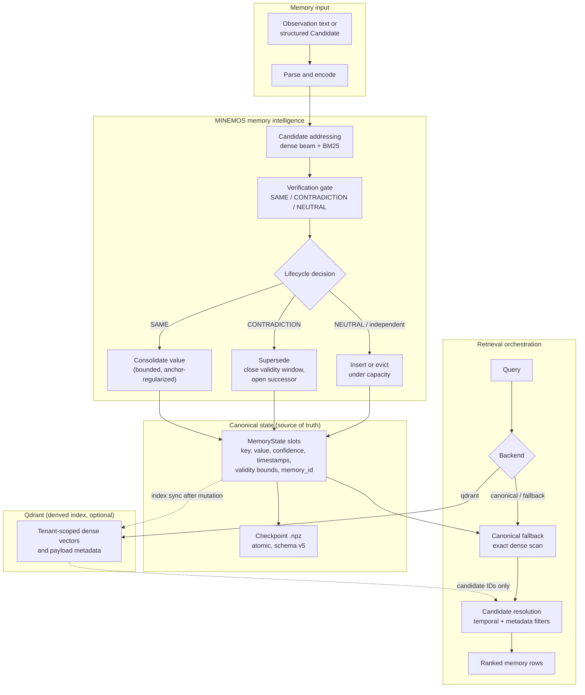

# MINEMOS

**A persistent memory system for AI applications that retains, consolidates, supersedes, and retrieves knowledge under a fixed capacity.**

[](https://github.com/robel-samuel/MINEMOS/actions/workflows/tests.yml)
[](LICENSE)

> **Research system.** MINEMOS is an experimental platform for studying memory
> lifecycle behavior. Its results come from controlled experiments on synthetic
> data. It is not a validated production memory service, and it is not a
> vector database or a retrieval-augmented generation wrapper. See
> [Status and maturity](#status-and-maturity) and [Limitations](#limitations).

---

## Contents

- [What MINEMOS is](#what-minemos-is)
- [Why memory needs more than retrieval](#why-memory-needs-more-than-retrieval)
- [Core idea](#core-idea)
- [Architecture](#architecture)
- [MINEMOS and Qdrant](#minemos-and-qdrant)
- [Retrieval modes](#retrieval-modes)
- [Status and maturity](#status-and-maturity)
- [Quick start](#quick-start)
- [Configuration](#configuration)
- [Tests](#tests)
- [Documentation](#documentation)
- [Research evidence](#research-evidence)
- [Limitations](#limitations)
- [Contributing](#contributing)
- [License](#license)

---

## What MINEMOS is

MINEMOS is a memory engine for AI applications. It accepts observations,
decides whether each observation reinforces, replaces, or adds to what it already
knows, stores the result in a fixed-capacity canonical memory, and returns
relevant state for later queries.

It is not a generic vector database and not an ordinary RAG layer. A vector index
can accelerate candidate retrieval, but it does not decide what is remembered,
what is outdated, what is superseded, or what survives capacity pressure. Those
decisions belong to MINEMOS.

The engine maintains:

- **Memory slots** with a frozen key, a consolidated value, confidence,
  timestamps, validity bounds, a stable `memory_id`, and supersession links.
- **Consolidation** of repeated or paraphrased facts using bounded,
  anchor-regularized value updates.
- **Contradiction handling** that distinguishes genuine state revision from
  independent facts about the same subject.
- **Temporal validity** with half-open intervals, point-in-time queries, and
  queryable history after supersession.
- **Tiered retention and eviction** under a hard capacity limit.
- **Canonical persistence** through atomic `.npz` checkpoints.
- **Retrieval** through exact canonical dense search, with an optional derived
  Qdrant index and optional in-process snapshot backends.

---

## Why memory needs more than retrieval

A context window is finite, and a stateless model forgets everything between
interactions. Simply retrieving more text does not solve the underlying problem:

- **Relevance is not the same as truth.** Retrieval can return an old fact and a
  newer, conflicting one with similar scores.
- **Similarity is not the same as sameness.** A paraphrase should reinforce a
  memory; a changed value should replace it. Dense similarity alone cannot
  reliably tell these apart.
- **Storage is not memory management.** A store that only appends eventually
  fills with duplicates, stale values, and contradictory records.
- **Capacity is a real constraint.** When memory is full, something must be
  chosen for eviction, and that choice determines what can still be recalled.
- **History matters.** After a fact is superseded, the previous state may still
  be needed for point-in-time queries and audit.

MINEMOS treats these as first-class lifecycle problems rather than retrieval
edge cases.

---

## Core idea

Each memory slot stores a **frozen key** `k_i` and an updated **value** `v_i`.
The key anchors retrieval and does not drift. On a SAME decision, the default
`hybrid` consolidation mode bounds one update step and then regularizes the
result toward the key:

```text
delta   = alpha * (x_t - v_prev)
delta   = clip(delta, delta_max)
v_next  = normalize((1 - lambda_anchor) * (v_prev + delta)
                    + lambda_anchor * key)
```

where `alpha` is novelty (`1 - max dense similarity` to the candidate set),
`delta_max = 0.25`, and `lambda_anchor = 0.20`. The key stays fixed, so repeated
paraphrases cannot indefinitely rotate the stored representation away from its
original meaning. Exact implementation details and alternative modes are in
[Memory Lifecycle](docs/architecture/memory-lifecycle.md#consolidation).

---

## Architecture

The canonical memory is the source of truth. Qdrant, when enabled, is a derived
index that returns candidate IDs; MINEMOS resolves those IDs against canonical
slots, applies its own temporal and metadata rules, and performs the final exact
re-ranking.



Every mutation is committed to canonical state before the optional index is
reconciled. If the index is unavailable, the memory decision still stands and
queries fall back to canonical retrieval. The index is rebuildable and never
authoritative.

More detail: [Architecture Overview](docs/architecture/overview.md) ·
[Memory Lifecycle](docs/architecture/memory-lifecycle.md) ·
[Retrieval](docs/architecture/retrieval.md).

---

## MINEMOS and Qdrant

Qdrant is retrieval infrastructure, not the memory authority.

| Concern | MINEMOS | Qdrant |
|---|---|---|
| Decide whether a fact is remembered | Owns | Not involved |
| Consolidation and value updates | Owns | Not involved |
| Contradiction, supersession, validity windows | Owns | Not involved |
| Retention and eviction | Owns | Not involved |
| Canonical state and checkpoints | Owns | Not stored authoritatively |
| Dense candidate search | Configures and re-ranks | Executes |
| Temporal and metadata filters | Re-applies exactly | Pre-filters |
| Index recovery | Rebuilds from canonical state | Rebuildable derived index |

A Qdrant hit can appear in a result only after it resolves to a live canonical
slot. Unknown or stale IDs are dropped. Configuration, tenancy, recovery, and
failure isolation are documented in
[Qdrant Integration](docs/architecture/qdrant-integration.md).

The historical Phase 31B/31C evaluation rejected Qdrant as an **authoritative**
memory store. The current integration uses a different role — a derived
retrieval index — and does not revise that verdict or claim Qdrant superiority.

---

## Retrieval modes

`retrieval_mode` selects the deployment profile:

| Mode | Behavior |
|---|---|
| `legacy` (default) | Canonical retrieval unless a backend is selected explicitly. Existing installations are unchanged. |
| `production` | Qdrant is the required retrieval backend. Configuration is validated at construction; missing or unsafe settings raise `RetrievalConfigurationError`. Runtime outages fall back to canonical and report `degraded`. |
| `canonical` | Canonical only. Qdrant is never constructed or contacted, even if `QDRANT_*` variables are set. |

`production` is a **strict retrieval deployment profile**, not a claim that the
research system is production-ready. Resolution order is constructor argument,
`MINEMOS_RETRIEVAL_MODE`, `RetrievalConfig.mode`, then `legacy`. See
[Configuration](docs/guides/configuration.md#retrieval-modes).

---

## Status and maturity

| Area | Status | Notes |
|---|---|---|
| Slot lifecycle: absorb, consolidate, contradict, supersede, temporal validity | **Implemented** | Covered by the test suite; synthetic evaluation |
| Tiered retention and eviction | **Implemented** | Default policy `tiered` |
| Canonical dense retrieval and `recall` | **Implemented** | Reference retrieval path |
| Checkpoint persistence | **Implemented** | Atomic `.npz`, schema v5, v1–v4 archives readable |
| Stable memory IDs and supersession links | **Implemented** | Introduced in schema v4 |
| Privacy redaction with chain-safe tombstones | **Implemented** | Schema v5; excludes content from reads, index, and archives |
| Qdrant derived retrieval index | **Implemented** | Optional; canonical state remains authoritative |
| `legacy` / `production` / `canonical` modes | **Implemented** | Strict production validation and runtime fallback |
| Metadata filters | **Implemented** | Pushed to Qdrant and re-applied in MINEMOS |
| Hybrid dense + BM25 candidate expansion | **Implemented (opt-in query)** | `hybrid=True` requires the Qdrant backend |
| Optimized and incremental snapshot backends | **Experimental, opt-in** | Exact-ranking parity tested; not defaults |
| Reciprocal-rank fusion (`fusion="rrf"`) | **Experimental, opt-in** | Ordering experiment; no quality claim |
| Qdrant integration benchmark | **Experimental evidence** | Synthetic corpora up to 1,000 target facts |
| Full-scale end-to-end accuracy on the integrated engine | **Planned** | Phase 23 measured individual failure modes, not a full integrated E2E result |
| HTTP service boundary | **Implemented, locally verified** | API-key auth, roles, tenant scoping, validation, rate limiting, TLS listener; no external IdP or audit |
| Real-data ingestion pipeline | **Implemented, locally verified** | Boundary-preserving conversation/document/prose parsing, provenance, deletion/redaction |
| Real-world evaluation environment | **Ready, verified with synthetic fixtures** | Dedicated store, independent ground truth, versioned results; no real-world run yet |
| 30-day continuous evaluation | **Not started** | Pre-registered protocol; zero days elapsed |
| Residual paraphrase rejection research | **Planned** | 13.3% false rejection on the Phase 28 held-out synthetic set |
| 100K-scale production validation, latency SLOs, HA, multi-process ingestion | **Not yet production-validated** | Not measured or supported |

The suite currently collects **660 tests** (659 pass, 1 skip). CI runs the suite on Python 3.12 and
performs a dependency vulnerability audit. See
[`.github/workflows/tests.yml`](.github/workflows/tests.yml).

---

## Quick start

### Requirements

- Python 3.12 (the version used by CI and the pinned dependencies)
- CPU-only PyTorch; no GPU is required
- Disk space for the virtual environment and the two model downloads
- Optional: a Qdrant server for the `production` profile; the canonical engine
  does not need it

### Install

```bash
git clone https://github.com/robel-samuel/MINEMOS.git
cd MINEMOS

python -m venv .venv

# Windows
.venv\Scripts\activate

# Linux / macOS
source .venv/bin/activate

pip install torch==2.14.0+cpu --index-url https://download.pytorch.org/whl/cpu
pip install -r requirements.txt
```

Download the two models once while online:

```bash
python - <<'PY'
from transformers import AutoTokenizer, AutoModelForSequenceClassification, AutoModel

AutoTokenizer.from_pretrained("cross-encoder/nli-distilroberta-base")
AutoModelForSequenceClassification.from_pretrained("cross-encoder/nli-distilroberta-base")
AutoTokenizer.from_pretrained("sentence-transformers/all-MiniLM-L6-v2")
AutoModel.from_pretrained("sentence-transformers/all-MiniLM-L6-v2")
print("Models ready.")
PY
```

### Minimal working example

Run this from the repository root. It inserts a fact, supersedes it with a newer
value, queries the active state, and retrieves the historical state as of an
earlier timestamp.

```python
from phase2.black_hole_memory import BlackHoleMemory
from phase2.structured_candidate import Candidate

mem = BlackHoleMemory(capacity=50)

mem.absorb(Candidate("Alice", "city", "New York"), timestamp=10.0)
result = mem.absorb(Candidate("Alice", "city", "Boston"), timestamp=20.0)
print(result["action"])  # temporal_update

for row in mem.query("what city is Alice in", top_k=3):
    print(row["text"], row["valid_from"], row["valid_until"])
# Alice city Boston. 20.0 None

for row in mem.recall("Alice", "city", as_of=15.0):
    print(row["text"], row["valid_from"], row["valid_until"])
# Alice city New York. 10.0 20.0
```

`absorb()` also accepts a `(subject, predicate, object)` tuple or a simple
`"Subject Predicate Object."` string. Query rows are dictionaries; see
[Retrieval](docs/architecture/retrieval.md#query-api) for every field.

### Save and restore

```python
mem.save_checkpoint("state/memory.npz", create_backup=True)

restored = BlackHoleMemory.from_checkpoint("state/memory.npz")
print(restored.status()["active_slots"])
```

`from_checkpoint` constructs a new engine. To load into an existing engine, use
`mem.load_checkpoint(path)`. See [Recovery](docs/operations/recovery.md).

### Canonical-only retrieval

```python
mem = BlackHoleMemory(capacity=100, retrieval_mode="canonical")
```

No Qdrant client is constructed and no Qdrant environment variable is read.

### Production retrieval with Qdrant

Start a Qdrant server, then provide a server URL. Values below are placeholders.

```bash
export QDRANT_URL="https://qdrant.example.com:6333"
export QDRANT_API_KEY="YOUR_QDRANT_API_KEY"
export MINEMOS_RETRIEVAL_MODE="production"
```

```python
from phase2.black_hole_memory import BlackHoleMemory

mem = BlackHoleMemory()  # fails fast if production configuration is invalid
```

Production validation requires a server-mode `QDRANT_URL`, rejects embedded
`QDRANT_PATH`, requires HTTPS and an API key for non-loopback hosts, and rejects
`QDRANT_RECREATE=true`. Loopback hosts are exempt from the TLS and API-key rules.
A runtime outage does not lose accepted memories: the index is marked dirty,
queries fall back to canonical retrieval, and `retrieval_stats()` reports
`degraded`.

---

## Configuration

The canonical engine needs no environment variables and no external service.
Common constructor parameters:

| Parameter | Default | Purpose |
|---|---|---|
| `capacity` | `100` | Maximum stored slots, including superseded history |
| `retention_policy` | `"tiered"` | Eviction policy |
| `verification_mode` | `"bidirectional"` | NLI comparison mode |
| `consolidation_mode` | `"hybrid"` | Value update mode |
| `retrieval_mode` | `None` | `legacy`, `production`, or `canonical` |
| `retrieval_backend` | `None` | `canonical`, `optimized`, `incremental`, or `qdrant` |

Frozen research parameters (`delta_max=0.25`, `lambda_anchor=0.20`, anchor
weights) are experimental controls, not tuning knobs. The full parameter and
environment-variable reference is in
[Configuration](docs/guides/configuration.md).

---

## Tests

```bash
python -m pytest tests/ -q
```

The suite collects **660 tests**. Cache both model weights first (see
[Quick start](#quick-start)). Qdrant integration tests use an embedded Qdrant
database by default; run them against a server with:

```bash
MINEMOS_QDRANT_URL=http://127.0.0.1:6333 \
  python -m pytest tests/test_qdrant_integration.py -q
```

CI runs the suite on Python 3.12 and performs a dependency vulnerability audit.
A green suite is evidence that the tested behaviors hold; it is not a
correctness guarantee for untested workloads.

---

## Documentation

| Topic | Document |
|---|---|
| Documentation index | [docs/README.md](docs/README.md) |
| Architecture overview | [docs/architecture/overview.md](docs/architecture/overview.md) |
| Memory lifecycle | [docs/architecture/memory-lifecycle.md](docs/architecture/memory-lifecycle.md) |
| Retrieval | [docs/architecture/retrieval.md](docs/architecture/retrieval.md) |
| Qdrant integration | [docs/architecture/qdrant-integration.md](docs/architecture/qdrant-integration.md) |
| Installation | [docs/guides/installation.md](docs/guides/installation.md) |
| Configuration | [docs/guides/configuration.md](docs/guides/configuration.md) |
| Deployment | [docs/guides/deployment.md](docs/guides/deployment.md) |
| Research overview | [docs/research/README.md](docs/research/README.md) |
| Phase history | [docs/research/history.md](docs/research/history.md) |
| Benchmark methodology and results | [docs/research/benchmark-methodology.md](docs/research/benchmark-methodology.md) |
| Monitoring | [docs/operations/monitoring.md](docs/operations/monitoring.md) |
| Recovery | [docs/operations/recovery.md](docs/operations/recovery.md) |
| Troubleshooting | [docs/operations/troubleshooting.md](docs/operations/troubleshooting.md) |
| Historical reports | [reports/](reports/) |
| Raw benchmark results | [benchmarks/results/](benchmarks/results/) |

Repository layout:

```text
phase2/                  Engine, memory state, checkpoints, retrieval backends
core/                    Phase 1 reference implementation
benchmarks/              Experiment runners and raw results
reports/                 Historical phase and audit reports
tests/                   Test suite
docs/                    Architecture, guides, research, and operations
```

---

## Research evidence

All numbers below are from controlled synthetic experiments and retain their
original caveats. They are not production guarantees. Raw artifacts are in
[`benchmarks/results/`](benchmarks/results/) and the reports linked from
[Phase history](docs/research/history.md).

| Phase | Question | Reported result |
|---|---|---|
| 23 | Where do end-to-end failures originate? | Eviction (Category D) accounted for 48.2% of failures at scale; oracle retention moved accuracy from 0.0% to 40.0% |
| 24–28 | Does tiered retention plus calibrated verification close those failures? | Target survival 100.0% (20/20) at C=25, N=320; contradiction detection 100.0%; false merge 0.00% on the held-out synthetic set |
| 28 | Does anchor-bounded consolidation resist drift? | Minimum cosine to `v0` rose from 0.9520 to 0.9826 over a 9-update paraphrase chain (63.65% less drift) |
| 28 | Does adaptive retrieval resist interference? | R@1 = MRR = 1.000 in all four conditions; all five methods tied at this ceiling |
| 2026-11-03 | Does Qdrant reproduce canonical ranking? | Dense results matched canonical dense results on synthetic corpora up to 1,000 target facts, because final ranking is exact and runs in MINEMOS |

The Qdrant integration benchmark does not revise the Phase 31B/31C verdict and
does not establish 100K-scale quality. See
[Benchmark Methodology](docs/research/benchmark-methodology.md) for tables,
environment, and reproduction commands.

---

## Limitations

- **Research, not production validation.** The system has not been validated on
  real conversational workloads, at 100K scale, or against latency SLOs.
- **Synthetic evaluation.** Reported accuracy figures come from controlled
  datasets with known ground truth.
- **Qdrant is derived.** It cannot override canonical state. Losing the index
  affects retrieval latency and candidate recall, not the facts themselves.
- **Capacity includes history.** Superseded slots occupy capacity until evicted.
  Frequent supersession needs headroom beyond the active fact count.
- **One writer per canonical memory.** In-process access is thread-safe, but
  multiple processes writing the same checkpoint are not coordinated.
- **Simple observation parsing.** `absorb()` accepts structured candidates,
  tuples, or a simple three-part sentence split; it is not a general natural
  language extraction pipeline.
- **Residual paraphrase rejection.** The verification model rejected 13.3% of
  valid paraphrases on the Phase 28 held-out synthetic set.
- **Partial unlinked-conflict detection.** Conflicts between independent active
  facts are detectable, but the broader U1 criteria remain partially resolved;
  see [`reports/U1_AUDIT_REPORT.md`](reports/U1_AUDIT_REPORT.md).
- **Backup semantics.** A `.bak` checkpoint can restore facts deleted after the
  previous save. It is not secure erasure.
- **Service boundary is not a hardened perimeter.** The bundled stdlib HTTP
  service adds authentication, roles, validation and rate limiting, but there is
  no container image, external identity provider, gateway, metrics exporter, or
  multi-process ingestion coordinator. Do not expose the engine directly to
  untrusted clients without those protections.
- **Real-world evaluation is not run.** The ingestion and evaluation
  environment is prepared and locally verified; the 30-day protocol has not
  started and no real-world accuracy claim exists.

Operational constraints and deployment expectations are in
[Deployment](docs/guides/deployment.md) and
[Troubleshooting](docs/operations/troubleshooting.md).

---

## Contributing

MINEMOS is a research codebase. Contributions that fix lifecycle defects, add
controlled experiments, improve test coverage, or document existing behavior are
welcome. Open an issue before changing frozen baselines, the verification gate,
or the retrieval pipeline.

Quantitative contributions must state dataset size, capacity, and seed, and must
report negative findings as well as positive ones. See
[CONTRIBUTING.md](CONTRIBUTING.md).

---

## License

MINEMOS is licensed under the **GNU Affero General Public License v3.0
(AGPL-3.0)**. See [LICENSE](LICENSE) for the complete text.

The AGPL-3.0 requires that modified versions run as a network service make their
source available to users of that service. For research and local use, it adds
no restrictions beyond standard open-source attribution.

---

*MINEMOS is an experimental research system. All benchmark results are from
controlled experiments on synthetic data and should not be interpreted as
guarantees of production performance.*
