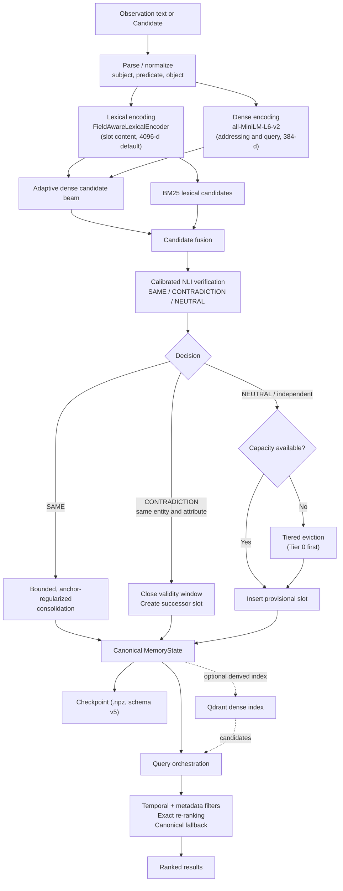

# Architecture Overview

MINEMOS is a memory system for AI applications. It ingests observations, decides
whether each observation reinforces, replaces, or adds to what it already knows,
stores the result in a fixed-capacity canonical memory, and retrieves the
relevant state for later queries.

It is not a vector database and not a retrieval-augmented generation wrapper. A
vector index can be attached as a retrieval accelerator, but it does not decide
what is remembered, what is superseded, or what survives capacity pressure. Those
decisions belong to MINEMOS.

This page describes the implemented system. Research motivation and historical
measurements are in [Research](../research/README.md); deployment guidance is in
[Deployment](../guides/deployment.md).

## System boundary

| Layer | Responsibility |
|---|---|
| Observation input | Natural-language text or explicit `(subject, predicate, object)` candidates |
| MINEMOS memory intelligence | Candidate addressing, consolidation, contradiction handling, supersession, temporal validity, retention and eviction |
| Canonical state | Authoritative in-process `MemoryState` plus `.npz` checkpoints |
| Retrieval orchestration | Candidate retrieval, metadata/temporal filtering, exact re-ranking, canonical fallback |
| Qdrant (optional) | Derived dense-vector index and candidate search scoped per tenant |
| Query output | Ranked row dictionaries with slot metadata and temporal bounds |

## Data flow

The dotted path is optional and never authoritative. Canonical state is written
before the index is reconciled, and every Qdrant hit is resolved back to a live
canonical slot before it can appear in a result.

## Core components

| Component | Location | Role |
|---|---|---|
| `BlackHoleMemory` | `phase2/black_hole_memory.py` | Unified engine: `absorb`, `query`, `recall`, lifecycle and backend coordination |
| `MemoryState`, `MemorySlot` | `phase2/memory_state.py` | Canonical slots, stable `memory_id`, validity windows, capacity enforcement |
| Candidate/encoding | `phase2/structured_candidate.py`, `phase2/encoders.py` | Structured observations and deterministic lexical encoding |
| Consolidation | `benchmarks/phase24_consolidation.py` | Bounded and anchor-regularized value updates |
| Verification | `benchmarks/phase24_verification.py` | Calibrated bidirectional NLI decisions |
| Retention | `benchmarks/phase24_retention.py` | Tiered and baseline eviction policies |
| Retrieval backends | `phase2/retrieval/` | Canonical reference, optional snapshot backends, Qdrant |
| Checkpoints | `phase2/checkpoint.py` | Atomic persistence, checksums, schema versioning |
| Legacy store | `core/memory.py` | Phase 1 subject/predicate implementation, kept for reference |

## Where state lives

1. **Canonical memory** is the source of truth. Each slot carries a frozen key,
   a consolidated value, confidence, timestamps, validity bounds, a stable
   `memory_id`, and supersession links.
2. **Checkpoints** persist canonical memory atomically to `.npz` archives.
   Schema v4 adds stable memory IDs and schema v5 adds redaction tombstones;
   v1–v4 archives load unchanged.
3. **Qdrant** stores a derived vector, payload metadata, and filters per slot
   under the same `memory_id`. It is rebuildable from canonical state and may be
   stale after an outage; queries fall back to canonical retrieval while the
   index is unhealthy.

Predicate policy overrides and retrieval configuration are process settings and
are intentionally not serialized in checkpoints. An archive stores facts, not
deployment configuration.

## Concurrency and consistency

- One engine owns one canonical state. Mutations and queries are serialized by an
  internal re-entrant lock.
- Retrieval-derived state is invalidated before each mutation through a
  monotonic state version. The optional snapshot backends use that version to
  detect stale snapshots.
- Direct out-of-band writes to `MemorySlot` fields or `memory.slots` are
  unsupported; they bypass invalidation.
- Multi-process writers to the same checkpoint are not supported. Run one engine
  per canonical memory, or partition by tenant.

See [Retrieval](retrieval.md) for backend-specific consistency rules and
[Operations: Recovery](../operations/recovery.md) for restart behavior.
