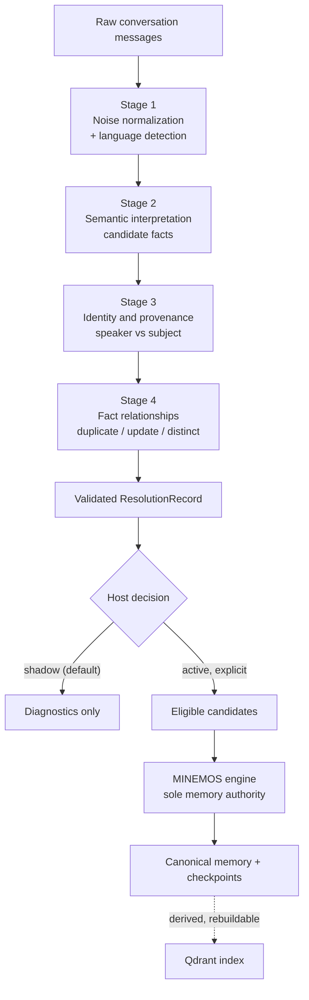

# Semantic Resolution Layer

The semantic resolution layer is an optional, candidate-only pre-processing
layer that sits in front of the memory engine. It reads raw conversation
messages, normalizes surface noise, extracts candidate facts, works out who
each fact is about, and compares each candidate with earlier candidates. It
emits a structured record. It does not write memory.

MINEMOS remains the only memory authority. The layer never calls
`absorb`, never decides whether two observations are the same stored fact,
never supersedes, never evicts, and never touches Qdrant. Those decisions stay
in the engine, which still receives ordinary observations or candidates.



## What the layer is for

Real conversation text is noisy. Messages arrive misspelled, lowercase,
abbreviated, code-switched, and with pronouns whose referent is a previous
message. A statement about someone's brother can easily be mistaken for a
statement about the speaker. The layer's job is to make those ambiguities
explicit before anything reaches memory:

- normalize surface noise without changing what the message means;
- extract candidate facts with evidence spans instead of free-form guesses;
- attribute each candidate to a speaker and a subject, or say it is unknown;
- classify a candidate against earlier candidates, or abstain;
- keep an auditable link from every fact back to the original text.

Everything the layer produces is a proposal. The engine is free to ignore it.

## The four stages

### Stage 1 — noise normalization

`minemos/resolution/normalize.py`, `language.py`

| Does | Does not |
|---|---|
| Case, whitespace, Unicode compatibility, repeated-word and punctuation cleanup | Rewrite the message in place |
| Contraction and informal-expansion edits drawn from closed lists | Invent missing words or meanings |
| Single-edit spelling correction against a closed functional vocabulary | Correct names, places, numbers or dates |
| Detect the primary language and code-switching | Translate anything |
| Record every edit with a source span and confidence | Discard the original text |

The normalized text is a separate value. `NormalizedText.original` keeps the
input byte for byte, every edit is a `TextEdit` with a type, source span,
replacement, confidence and reason, and token spans map back into the original
string. URLs, e-mail addresses, numbers and dates are protected spans and are
never edited or split. Edits applicable only to English are skipped when the
detected language is something else.

Code-switching is reported only when a second language has evidence of its
own: a word shared with the primary language does not count, and neither does
a single borrowed-looking word, so ordinary English text that happens to use
`per` or `the` is not labelled multilingual. A second script always counts.

Latin-script switching relies on weighted function words. A second language is
reported when its own stopword evidence reaches 1.0 and it contributes either
two distinct types or at least a fifth of the Latin words; `switched_script`
forces the flag when the writing system itself changes between words. This is
deliberately strict. A short Spanish clause made only of names and English
cognates ("Me llamo Ana") carries no Spanish-only function word, so the
detector may leave the message unflagged as mixed even though a human reads a
code-switch. The flag is advisory; the extracted facts are unaffected.

### Stage 2 — semantic interpretation

`minemos/resolution/interpret.py`

Extracts candidate facts from a normalized message: subject, predicate, value,
entities, temporal expressions, negation polarity, modality, confidence and the
evidence span in the original text. English and Spanish/French first-person
rules are supported, plus a small code-switch path. Hypotheticals and questions
are abstained explicitly. The stage never decides truth, never writes memory
and never merges facts.

A clause that opens with a third-person verb is only attributed to a named
person when the words plausibly form a name: no function word, consistent
casing, and, for lower-case text, a message-initial position and at least one
word outside ordinary vocabulary. Free chat is full of fragments like "See
your Google plays ...", and inventing a person from one would be worse than
admitting the gap. Such a clause keeps its candidate fact but the subject is
`ambiguous`, with the reason `name_not_proper_noun` and an
`unresolved_subject` abstention.

Spanish and French possessive relations can head an ordinary predicate as well
as a name: "Mi madre vive en Lima", "Mon frère habite à Nantes". The verb and
preposition decide the predicate (`vive`/`habite` → `lives_in`,
`trabaja para`/`travaille chez` → `works_at`, `trabaja en`/`travaille à` →
`works_in`), and the subject stays `derived` with the relation recorded — never
the speaker. A relation and a first-person clause can share one message
("Me llamo Ana and I work at Acme") and produce one speaker fact and one
derived fact.

### Stage 3 — identity and provenance

`minemos/resolution/identity.py`

Separates the three identities that conversational text blurs: the speaker,
the subject the fact is about, and any entity referenced. A first-person
statement resolves to the speaker; "my brother lives in Dubai" resolves to a
derived relation subject, not the speaker; a name resolves to a named subject.
Pronouns resolve only inside the same conversation and only with a preceding
antecedent. An antecedent with a recorded gender must agree with the pronoun;
a uniquely named person whose gender is not recorded (for example "my colleague
is called Ivo" followed by "he") is accepted only when it is the single person
in the window, so two candidate people leave the reference unresolved. Identity
transitions (for example, a pronoun that starts referring to a new person) are
appended, not rewritten, so earlier provenance stays correct. Unresolved
subjects are marked `unknown` rather than guessed. Only a resolved named
subject joins the conversation's people registry, so an unverified candidate
can never become a pronoun antecedent or a source of name variants later.

Two relations given the same name are two people. "My brother is called Sam"
followed by "my colleague is called Sam" records both relations against their
own identities; the bare name becomes ambiguous, so a later "Sam lives in
Oslo" and a later "he"/"she" abstain (`ambiguous_name_reference`,
`pronoun_ambiguous_name`) instead of picking one. Relation links are keyed by
owner and relation, so the same "my brother" from two speakers in one
conversation is also two people. A correction that fits two registered people
abstains (`correction_target_ambiguous`), and a correction that resolves
carries no leftover ambiguity.

### Stage 4 — fact relationships

`minemos/resolution/relationships.py`

Compares each candidate with earlier candidates in the same conversation and
labels the pair:

| Label | Meaning |
|---|---|
| `duplicate` | Same fact, restated (including surface variation and paraphrase) |
| `temporal_update` | A value change for a functional predicate, with time or an explicit transition marker |
| `historical_observation` | A past-state statement that does not replace the current state |
| `distinct_fact` | Different fact, or a cumulative addition |
| `unresolved` | Evidence is not sufficient; the layer abstains |

Every label carries evidence strings and a confidence. Near-miss values,
polarity conflicts without a time marker, and values that differ without a
temporal signal stay `unresolved` or `distinct_fact` — never silently merged.
The layer does not consolidate, supersede, contradict or evict; it only
describes what it sees so the engine and the host can decide.

## Output contract

A resolve call returns one `ResolutionRecord` (`minemos/resolution/contracts.py`),
validated by `validate_record()` before it is returned. `to_dict()` produces the
JSON form and `validate_with_schema()` checks it against
`minemos/resolution/schema.json`:

| Field | Content |
|---|---|
| `record_version` | `minemos.resolution/1` |
| `source` | Conversation id, message id, speaker, timestamp, order |
| `normalized` | Original text, normalized text, tokens, reversible edits |
| `language` | Primary language, confidence, mixed flag, spans |
| `entities` | Text, type, span, confidence, rule |
| `facts` | Subject reference, predicate, value, polarity, modality, temporal expression, confidence, evidence span, fact id |
| `attributions` | Speaker, subject, scope, status, evidence |
| `relationships` | Label, target fact id, evidence, confidence |
| `transitions` | Append-only identity transitions with prior provenance |
| `stage_confidence` | Per-stage confidence summary |
| `abstentions` | Explicit reasons the layer declined to extract or classify |

Validation enforces the invariants the rest of the system relies on: spans
inside the source, facts tied to a known attribution, relationship targets that
exist, confidence within `[0, 1]`, and a stage name from the fixed list.
Records are frozen dataclasses; nothing downstream can mutate them.

## Integration modes

| Mode | Behaviour |
|---|---|
| `disabled` | The resolver returns an empty record and does nothing |
| `shadow` (default) | Full pipeline, counters only; no engine writes |
| `active` | Opt-in: the host may pass records to the bridge |

### Shadow mode

`ShadowRunner` runs the resolver beside the existing pipeline and keeps
counters: fact counts, relationship mix, subject kinds, languages, coverage,
abstentions, bridge eligibility, and a comparison against a baseline fact set.
Its `log_line()` is built from counters and hashes only — no message text, no
fact values, no entity names. `value_token()` produces a short SHA-256 prefix
when a value must be compared in diagnostics.

Shadow mode does not change retrieval, does not change consolidation, and does
not write canonical state. It is the default for a reason: the layer is useful
for measurement before it is trusted for writes.

### Host shadow observer

`minemos/resolution/host.py` is the host-facing adapter. A host that already
owns canonical ingestion creates one `HostShadowObserver`, hands it the
conversation messages it just ingested, and keeps the returned counters:

```python
from minemos.resolution import (
    HostShadowObserver, ShadowSettings, SourceMessage,
)

observer = HostShadowObserver(ShadowSettings(
    enabled=True,               # explicit; disabled by default
    report_path="shadow.json",  # optional atomic JSON report
    log_every=100,              # one counter log line per 100 messages
))
counters = observer.observe([
    SourceMessage(conversation_id="conv-1", message_id="m-1",
                  text="I live in Berlin.", speaker="user"),
])
```

Guarantees:

- The observer holds no engine handle and imports no writer. It cannot
  consolidate, contradict, checkpoint, evict or touch a retrieval index.
- It runs only when constructed with `enabled=True` and only with
  `ResolutionConfig(mode="shadow")`; a non-shadow config is rejected.
- Resolution, counting and reporting failures are caught per message or per
  call. A shadow failure never propagates to host ingestion.
- Memory is bounded: one resolver per conversation (LRU) and a fixed-capacity
  content-hash dedupe, so replayed or repeated messages are skipped.
- Counters, the periodic log line and the JSON report contain counts, hashes,
  state snapshots and casefolded tokens for comparison. Message text, entity
  names and fact values are not logged.
- `facts_eligible_if_active` classifies what the bridge *would* accept. It is a
  diagnostic, not an approval, and no record is passed to the engine.

The evaluation conversation host (`EvaluationEnvironment.ingest_segments`)
uses this adapter when `MINEMOS_RESOLUTION_SHADOW` is set, reports the effective
mode through `ServiceConfig.describe()`, `--check`, the startup log and
`GET /v1/status`, and adds a `shadow_resolution` block to its ingestion result
containing before/after canonical state snapshots. The `observer_mutation`
diff between those snapshots must be unchanged on every call.

### Active bridge

`minemos/resolution/bridge.py` is the only path from a record to the engine,
and only when the caller both configures `active` mode and calls
`absorb_record()` / `apply_records()` itself. Eligibility is deliberately
narrow:

- the subject must be resolved;
- the fact must be positively asserted and asserted in modality;
- the candidate must not be classified `unresolved` or `duplicate` against its
  own conversation.

Only then does the bridge build a `Candidate` and call `engine.absorb()`. Every
downstream decision — consolidation, contradiction, supersession, temporal
intervals, retention, eviction — remains the engine's.

### Native observation conversion

`minemos/resolution/native.py` is the conversion boundary introduced for the
opt-in native ingestion path. It turns a `ResolutionRecord` into values the
existing native contract already accepts — `Candidate` objects for the engine
and observation mappings for `validate_ingest_payload` — without changing that
contract, without writing memory and without inventing native fields:

```python
from minemos.resolution import ResolutionConfig, native_observations

conversion = native_observations(record, ResolutionConfig(mode="active"),
                                 segment_timestamp=segment.timestamp,
                                 ingestion_timestamp=run_started_at)
for item in conversion.observations:
    engine.absorb(item.as_candidate())        # or service payload
conversion.rejected                           # fact_id + explicit reason
conversion.to_dict()                          # content-free diagnostics
```

A fact is converted only when it would also pass the bridge rules: resolved
subject, positively asserted and asserted in modality, and not classified
`duplicate` or `unresolved`. The converter adds its own gates: at least
`extraction_confidence` (0.62, the resolver default), an in-message duplicate
key `(subject, predicate, value)` compared casefolded, and the native field
limits (subject 256, predicate 128, object 8,192 characters, no control
characters). Every decline is reported with a specific reason
(`below_confidence_threshold`, `duplicate_candidate`, `subject_unresolved`,
`subject_too_long`, `invalid_timestamp`, …); the converter never weakens an
eligibility rule silently.

Timestamps never default to `0.0`. The converter takes the first finite,
positive value in this order: the semantic observation timestamp, the original
segment timestamp supplied by the host, then the ingestion timestamp supplied
by the host. If none is valid the fact is rejected with `invalid_timestamp`.
Hosts should pass a stable ingestion timestamp so a replay produces identical
values.

The ingestion step is no longer implicit. Since V9 the converter's
`ingestion_fallback` flag defaults to fail-closed at the host: when neither
the record nor the segment carries a usable event time and the flag is off,
the otherwise-eligible fact is rejected with `timestamp_unavailable` instead
of being stamped with ingestion time. A fact stamped with the wall clock
cannot be superseded by a genuinely newer archived message, so hosts should
decide the fallback per conversation:

- every message timed → convert with explicit event times;
- some timed, some not (`mixed`) → convert only the timed messages; untimed
  facts cannot be placed on the timeline, so they abstain;
- none timed → abstain by default; pass `ingestion_fallback=True`
  explicitly only when the caller accepts that ingestion time stands in for
  event time.

The evaluation harness implements exactly this policy and reports the
classification (`timed`, `mixed`, `untimed`) plus a `timestamp_unavailable`
count. `_valid_timestamp` treats `0.0`, negative and non-finite values as
missing.

Identifiers are deterministic and satisfy the native pattern
`^[A-Za-z0-9][A-Za-z0-9._:-]{0,127}$`. `native_identifier()` returns a
conforming value unchanged, otherwise replaces unsafe characters
deterministically; `native_ingestion_id()` hashes the source identity
(`source_id`, `conversation_id`, `message_id`, `fact_id`) together with the
fact content (subject, predicate, SHA-256 of the object, timestamp,
confidence). The same input always yields the same id, so a replayed message
is recognized as already ingested rather than stored twice.

The record remains the audit source: evidence spans, value spans, polarity
and modality beyond the eligibility gate, temporal expressions, per-fact
language, entities, attributions, relationships, transitions and stage
confidence are not representable natively and are not claimed to be. The
native observation keeps only subject, predicate, object, confidence,
timestamp and provenance ids.

This conversion is implemented and covered by the public test suite. It is
not wired into any raw-text service endpoint, and nothing converts or absorbs
semantic facts unless a host explicitly calls it in `active` mode.

## Using the layer

```python
from minemos.resolution import Resolver, ResolutionConfig, SourceMessage

resolver = Resolver(ResolutionConfig(mode="shadow"))
result = resolver.resolve(SourceMessage(
    conversation_id="conv-1",
    message_id="m-1",
    text="My sister now works at Acme and I live in Berlin.",
    speaker="owner",
))
record = result.record
for fact in record.facts:
    print(fact.predicate, fact.value, fact.subject.kind, fact.subject.label)
```

Use `resolve_conversation()` when messages must share an identity session so
pronouns and repeated variants can resolve. Use `ShadowRunner` in application
code to keep a running report. Read `minemos/resolution/schema.json` if you
need the JSON shape in another language.

### Long messages

The resolver reads one message at a time and never truncates. A host that
accepts arbitrary-length messages should use the enforced entry point
`ingest_message()`, which segments at the published 8,192-character boundary
and resolves the chunks in source order on one resolver:

```python
from minemos.resolution import (
    ResolutionConfig, Resolver, SourceMessage, ingest_message,
)

resolver = Resolver(ResolutionConfig(mode="shadow"))
ingested = ingest_message(resolver, SourceMessage(
    conversation_id="conv-1",
    message_id="m-1",
    text=long_text,
    speaker="owner",
))
for item in ingested.chunks:
    print(item.message_id, item.char_start, item.char_end,
          len(item.record.facts))
```

`ingested.original_message_id`, `.conversation_id` and every chunk's
`char_start`/`char_end` stay available, so a record can be traced back to its
source text. Chunk ids are `m-1#0`, `m-1#1`, …; a message that already fits
keeps its original id. Chunks share the conversation id and are resolved in
source order, so a name introduced in one chunk resolves a pronoun in the
next, and a repeated fact is classified `duplicate` rather than written twice.
Fact evidence spans remain relative to the chunk's normalized text; add the
chunk's `char_start` to locate the chunk in the original message.

`ingest_conversation()` applies the same policy to an ordered conversation.
Two overflow policies are available:

| Policy | Behaviour |
|---|---|
| `IngestionPolicy()` (default) | segment losslessly; nothing is truncated |
| `IngestionPolicy(overflow="reject")` | refuse an oversized message with `MessageTooLongError` before resolving or writing |

`segment_message()` remains available for hosts that already own their
ingestion pipeline, and `Resolver.resolve()` stays a permissive text
processor. Nothing in the layer writes memory unless a host calls
`absorb_record()`/`absorb_ingested()` with an explicit `active` config.

## Configuration

`ResolutionConfig` is an immutable dataclass. Every default is local and
deterministic; nothing in the layer opens a socket.

| Setting | Default | Effect |
|---|---|---|
| `mode` | `shadow` | `disabled`, `shadow` or `active`; only `active` lets a host bridge records |
| `normalize_typos`, `normalize_contractions`, `normalize_informal`, `normalize_whitespace` | `true` | Stage 1 edit families |
| `max_typo_edits`, `typo_min_length`, `typo_confidence` | `1`, `3`, `0.82` | Spelling-correction bounds |
| `max_structural_edits` | `1` | Edit bound for recovering a misspelled verb or attribute name from the closed structural list; values and names are never eligible |
| `preserve_capitalized` | `true` | Never rewrite capitalized tokens (names, places) |
| `detect_language` | `true` | Language detection and code-switch spans |
| `extract_facts`, `max_facts_per_message` | `true`, `12` | Stage 2 extraction switch and cap |
| `extraction_confidence` | `0.62` | Minimum confidence for an emitted candidate |
| `expand_place_aliases` | `true` | Closed-list alias expansion (for example NYC) |
| `resolve_pronouns`, `pronoun_window` | `true`, `6` | Same-conversation pronoun resolution and look-back |
| `conversation_scope_only` | `true` | Refuse cross-conversation identity links |
| `link_repeated_variants`, `repeated_variant_support` | `true`, `2` | Promote a repeated spelling variant to a known alias |
| `name_variant_max_distance` | `2` | Levenshtein bound for name variants |
| `duplicate_similarity`, `ambiguous_similarity` | `0.86`, `0.62` | Stage 4 thresholds; between them a pair stays `unresolved` |
| `semantic_provider` | `hash` | `hash` (built in), `local` (engine encoder, no network) or `none`; a record's `provider` field reports the provider that actually ran |
| `include_spans` | `true` | Emit character spans for edits and evidence |

Invalid values raise `ValueError` at construction time, before any message is
processed.

## Privacy

The layer is local-first. There is no bundled network client and no default
endpoint. The built-in similarity providers are deterministic: a hash-based
lexical provider, and an optional wrapper around the engine's local encoder.
The engine encoder loads with `local_files_only=True`; if the engine package
or its cached model files are unavailable, `local` falls back to the hash
provider and the record reports `deterministic:hash`. Nothing is transmitted
anywhere unless a host explicitly configures a provider it wrote itself, and no
such provider ships with the project.

Diagnostics are counters, stage names, hashes and ids. Raw message text and
fact values belong to the host and stay there.

## Relationship to the engine's own consolidation

The engine already consolidates repeated observations and detects
contradictions. The resolution layer does not duplicate those decisions; it
adds the missing front half — normalization, attribution and relationship
proposals — and stays advisory. A useful way to read the boundary:

| Question | Answered by |
|---|---|
| What did the message say, cleaned up? | Stage 1 |
| What are the candidate facts? | Stage 2 |
| Who is each fact about? | Stage 3 |
| Is this the same fact as an earlier one, and on what evidence? | Stage 4 |
| Should anything actually be stored, superseded or forgotten? | The MINEMOS engine |

## Current status

The layer ships in shadow mode by default and changes no engine decision on its
own. Evaluation against real conversation data is run outside this repository
on a private corpus; the labels reference hashed message keys, and no
conversation text enters the repository or these documents.

The native conversion and dual-write path described above is implemented and
covered by the public and private test suites, and it has been exercised end
to end on the frozen real-conversation view (1,445 messages, 250
conversations):

- 82 semantic observations were absorbed and 67 facts were rejected with
  explicit reasons (`subject_unresolved` 25, `non_asserted_polarity` 22,
  `relationship_duplicate` 10, `relationship_unresolved` 10); no segment
  failed;
- every verbatim segment was preserved (1,469 slots) and slots grew to 1,546;
- the frozen-query baseline was reproduced exactly (Recall@5 0.6794) and the
  dual-write arm scored Recall@5 0.6853 and MRR 0.6070 against 0.6055 —
  2 queries won, 0 lost, 338 unchanged. Two queries on 340 is not evidence of
  a quality improvement;
- a bounded 40-conversation restart replay re-ingested nothing, created no new
  segments and no new slots.

Semantic absorption is not activated anywhere by default. There is no
raw-text service endpoint, and the only validated host is the private
evaluation environment; service integration is not implemented. The only
hand-labelled real sample (25 cases, 13 gold facts) shows 13/13 converted with
exact predicate, value and attribution, 0 duplicates, 5 no-fact and 2
abstention cases clean, and 5 relation mentions correctly not converted. That
sample is curated and small, so no corpus-wide precision, recall or activation
claim is made.

The figures below come from the synthetic frozen suites kept in the private
evaluation workspace. They describe this layer's proposal quality only. No
retrieval claim is made for multilingual content: the dense encoder is
English-trained, and the cross-lingual check in the frozen suite misses.

| Measurement | Result | Scope |
|---|---|---|
| Clean fact extraction | 585/585 = 1.0 | English audit, 585 expected facts |
| Noisy fact extraction | 485/585 = 0.829 | English audit, same facts after noise |
| Clean subject attribution | 585/585 = 1.0 | English audit |
| Noisy attribution, name intact | 440/490 = 0.898 | noisy rows where the name survived spelling noise |
| Noisy attribution, expected fact emitted | 440/485 = 0.907 | conditional on extraction succeeding |
| Speaker leaks (noisy) | 0/585 | third-person facts resolved to the speaker |
| False entity merges | 0/45 | adversarial near-miss name pairs |
| Relationship labels | 150/150 = 1.0 | frozen graded pairs |
| Multilingual extraction | 56/56 = 1.0 | 40 scenarios, am/es/fr/en + code-switching |
| Multilingual attribution | 56/56 = 1.0 | same suite |
| Multilingual relationships | 17/17 = 1.0 | same suite |
| Code-switch flag | 59/61 = 0.967 | messages labelled mixed |
| Language label | 45/56 = 0.804 | primary language equals label; wrong 0/56, the rest abstain to `und` |
| Same-language Recall@5 | 20/20 = 1.0 | 20-document entity-anchored corpus, chance 0.25 |
| Cross-lingual Recall@5 | 0/4 | reported separately; not a supported capability |
| Segmentation boundary cases | 11/11 | host splitter at 8,192/8,193, sentence/newline/hard cut, facts and identity across chunks |
| Attribution probe | 84/84 = 1.0 | synthetic speaker/relation/named/pronoun/relation-named families |
| Adversarial attribution set | 19/19 eligible = 1.0 | 26 hand-authored cases, 7 expected abstentions |

### Real-conversation acceptance sample

A curated sample of 25 hand-verified cases (24 distinct messages) was drawn
from the private export and replayed turn by turn from the start of each
conversation. It is deliberately a curated acceptance set, not a random
sample, so it yields no corpus-wide recall estimate; every message is scored
individually and every failure is listed. Labels record subject, predicate,
value, polarity and language.

| Measurement | Result | Scope |
|---|---|---|
| Gold facts extracted | 13/13 | first-person declarative cases |
| Attributed to the resolved speaker | 13/13 | the same 13 facts |
| Polarity exact | 13/13 | negation handling |
| Value exact | 7/13 | alphanumeric case-folded equality |
| Declinations handled cleanly | 7/7 | 5 no-fact messages, 2 expected abstentions |
| Abstention reasons recorded | 2 events | 1 hypothetical, 1 unresolved pronoun subject |
| Silent declines | 5 | no rule matched; reported as coverage gaps, not abstentions |
| Relation mentions | 0/5 derived subjects | all five are non-assertive contexts |
| Spurious resolved facts | 0 | no gold predicate on the message |
| Speaker leaks | 0 | third-person facts resolved to the speaker |
| Ungrounded named subjects | 0 | resolved names absent from the conversation |

Language denominators: English 24, code-switched 1 (Persian + English).
Amharic, Spanish and French real denominators are zero in this corpus, so the
real evaluation makes no claim for those languages; their evidence is the
synthetic 40-scenario suite only.

The acceptance criterion of at least 98% attribution on eligible verified
cases is met on this sample (13/13), with the caveat that 13 gold facts is a
small denominator. Cross-turn identity, pronoun resolution and relation
attribution are exercised by the synthetic probe families above, not by this
sample.

Known limits, all measured:

- A noun misspelled beyond one edit in a relation phrase ("myy brther") is not
  repaired; the fact is dropped or left unattributed. Value spelling is never
  corrected, so a misspelled place or organisation is kept as written.
- Two short Latin-script code-switches are not flagged mixed because the second
  language contributes no function word of its own or falls below the 1.0
  evidence threshold.
- Processing cost grows faster than linearly in the number of clauses in one
  message. Hosts must split messages above 8,192 characters with
  `segment_message()` before resolution; the resolver itself never truncates,
  and a single oversized message is slow (tens of seconds at ~2,300 facts).
- Cross-lingual retrieval is not supported by the English-trained encoder. Only
  same-language retrieval was verified.
- In unpunctuated running speech a value can absorb the next clause: 6 of the
  13 real gold facts were attributed with the right predicate and subject but
  an over-captured value. Clause boundaries are inferred from punctuation and
  a closed joiner list, so text with neither is not split. Removing the
  over-capture requires a parser and is deliberately not attempted.
- Nominal possession such as "it's my uncle's home" is not extracted as a
  relation fact; only explicit relation predicates are.
- False identity merges are not measurable on the real corpus because it has
  no gold merge labels. The synthetic adversarial sets report 0 merges, and
  the real sample reports 0 ungrounded named subjects and 0 speaker leaks.
